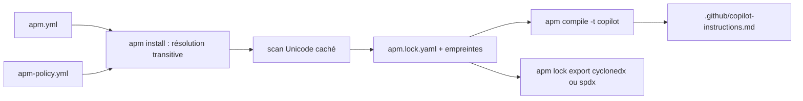

# microsoft/apm

> Dependency manager for coding-agent configuration, npm-style.

## The problem
Standards, prompts, skills and agent plugins are installed by hand, differently for each person.
Nothing is portable or reproducible between two machines or two clients.

## What it actually does
An `apm.yml` declares all agentic dependencies; `apm install` resolves them, transitive ones included.
`apm.lock.yaml` pins the resolved tree with integrity hashes, like a `package-lock.json`.
One manifest deploys to Copilot, Claude, Cursor, Codex, Gemini, Windsurf, Kiro and OpenCode.
`apm-policy.yml` lets a security team restrict sources, scopes and primitives, with restrictive inheritance.

## How it is wired


## Trying it
```bash
brew install apm
apm install microsoft/apm-sample-package#v1.0.0
apm compile -t copilot
```

## Cost and gotchas
Free, no account. Transitive MCP servers require explicit consent at install time.
`apm audit` rebuilds the context in a temporary space and compares it with your working tree.

## What it is not
Not a runtime sandbox: the policy governs what is installed, not what runs.
Not a compliance SBOM — the export is a provenance inventory, not an attestation.
Not a catalog: packages come from git repositories or third-party marketplaces.

## Alternatives
`npx skills add`, whose install gesture APM reuses.
agentrc, presented as complementary for generating the instructions to package.

## For you
Worth following if you start sharing skills between projects; still too young to depend on.
