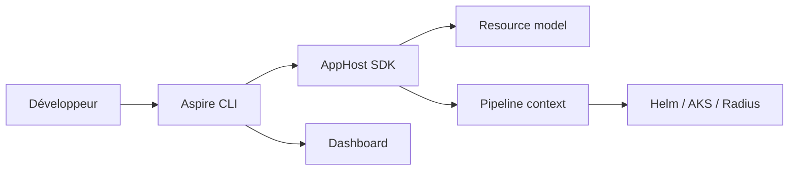

# microsoft/aspire

> Toolkit that describes a distributed multi-service app in code, runs it locally and deploys it.

## The problem
Wiring services, databases, caches and environment variables by hand is tedious, and the local setup differs from the deployment.

## What it actually does
You declare the app in an "AppHost" (C# `apphost.cs` or TypeScript `apphost.ts`): Redis, a Node app, a Vite front end, with references and waits (`WithReference`, `WaitFor`). The CLI runs everything locally with an OpenTelemetry dashboard. The same definition feeds deployment pipelines (Helm, AKS, Radius). The repository also contains a VS Code extension.

## How it is wired


## Trying it
```bash
curl -sSL https://aspire.dev/install.sh | bash
```

## Cost and gotchas
Free. Third-party containers (Redis, etc.) assume a container runtime; the README states that the team does not assess their compliance. Installation is via a `curl | bash` script.

## What it is not
Neither a production orchestrator (it describes and deploys), nor limited to .NET: the README also shows TypeScript. More than 2,700 open issues.

## Alternatives
No alternative named in the README.

## For you
Worth watching: useful for spinning up service platforms locally (model APIs, caches), but not central for a pure data/AI profile.
