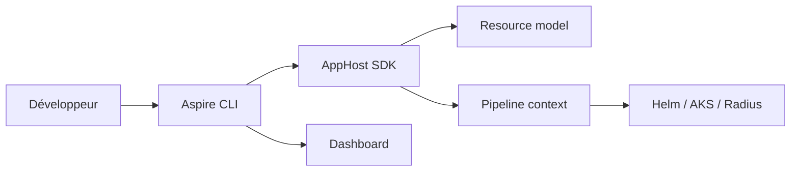

# microsoft/aspire

> Boîte à outils qui décrit en code une appli distribuée multi-services, la lance en local et la déploie.

## Le problème
Brancher à la main services, bases, caches et variables d'environnement est fastidieux, et le montage local diffère du déploiement.

## Ce que ça fait vraiment
Tu déclares l'appli dans un « AppHost » (C# `apphost.cs` ou TypeScript `apphost.ts`) : Redis, app Node, front Vite, avec références et attentes (`WithReference`, `WaitFor`). La CLI lance l'ensemble en local avec un tableau de bord OpenTelemetry. La même définition alimente des pipelines de déploiement (Helm, AKS, Radius). Le dépôt contient aussi une extension VS Code.

## Comment c'est branché


## Essayer
```bash
curl -sSL https://aspire.dev/install.sh | bash
```

## Coût et pièges
Gratuit. Les conteneurs tiers (Redis, etc.) supposent un runtime de conteneurs ; le README précise que l'équipe n'évalue pas leur conformité. Installation par script `curl | bash`.

## Ce que ce n'est pas
Ni un orchestrateur de production (il décrit et déploie), ni limité à .NET : le README affiche aussi du TypeScript. Plus de 2 700 issues ouvertes.

## Alternatives
Aucune alternative nommée dans le README.

## Pour toi
À surveiller : utile pour monter en local des plateformes de services (API de modèles, caches), mais pas central pour un profil data/IA pur.

