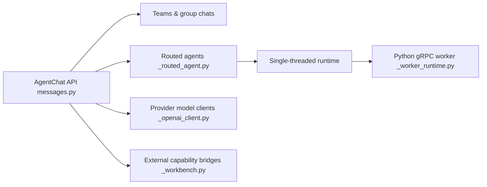

# microsoft/autogen

> Python/.NET multi-agent LLM framework, now in maintenance mode in favor of Agent Framework.

## The problem
Orchestrating several LLM agents, their tools and their turn-taking otherwise requires a lot of homegrown plumbing.

## What it actually does
Three layers: Core (event-driven runtime, messages, topics), AgentChat (AssistantAgent, round-robin teams, selector, swarm, graph, Magentic-One), Extensions (OpenAI, Anthropic, Ollama clients; Docker/Jupyter code execution; MCP).
Distributed gRPC runtime with a .NET gateway.
AutoGen Studio: no-code prototyping GUI; AGBench for evaluation.
**Maintenance mode**: fixes only, community-managed.

## How it is wired


## Trying it
```bash
pip install -U "autogen-agentchat" "autogen-ext[openai]"
pip install -U "autogenstudio"
autogenstudio ui --port 8080 --appdir ./my-app
```

## Cost and gotchas
The examples call the OpenAI API: key and bill at your expense. MCP servers can run local commands.

## What it is not
No longer Microsoft's recommended choice for a new project. Studio is not a production app (no auth). CC-BY-4.0 license for the docs, MIT for the code.

## Alternatives
- microsoft/agent-framework: official successor, long-term support.

## For you
Ignore for new work; migrate to Agent Framework if you have existing code.
