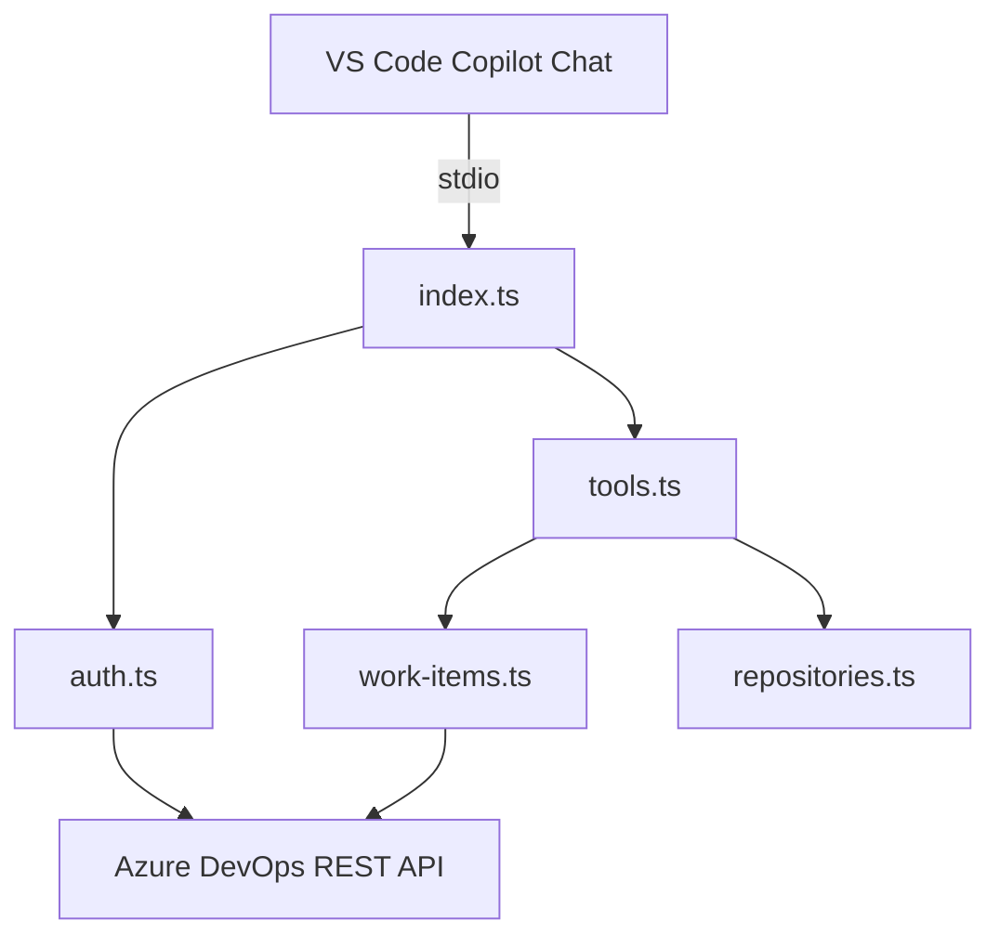

# microsoft/azure-devops-mcp

> MCP server that gives AI agents access to Azure DevOps: work items, repositories, pipelines, wikis.

## The problem
An agent cannot query Azure DevOps projects, builds and work items without an access layer.

## What it actually does
A thin layer over the Azure DevOps REST APIs, one tool per task, organized into domains (core, work-items, repositories, wiki, pipelines, search, test-plans, advanced-security). The local server goes through stdio; Microsoft now recommends the remote server.

## How it is wired
Diagram based on the supplied diagram.



## Trying it
```bash
npx -y @azure-devops/mcp {organization}
npx -y @azure-devops/mcp {organization} -d core work work-items
```

## Cost and gotchas
A Microsoft account with access to the Azure DevOps organization, Node 20+. Filter the domains to limit the number of tools.

## What it is not
Not independent of Azure DevOps. The local server is on its way to being replaced by the remote server.

## Alternatives
The remote MCP server (mcp.dev.azure.com), recommended by the README.

## For you
Worth watching: useful only if your team lives on Azure DevOps; otherwise irrelevant.
