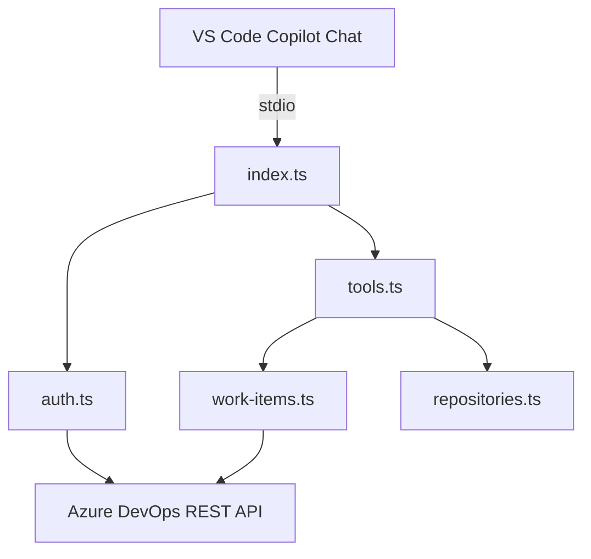

# microsoft/azure-devops-mcp

> Serveur MCP qui donne aux agents IA accès à Azure DevOps : work items, dépôts, pipelines, wikis.

## Le problème
Un agent ne peut pas interroger les projets, builds et work items Azure DevOps sans couche d'accès.

## Ce que ça fait vraiment
Une fine couche sur les API REST Azure DevOps, un outil par tâche, organisée en domaines (core, work-items, repositories, wiki, pipelines, search, test-plans, advanced-security). Le serveur local passe par stdio ; Microsoft recommande désormais le serveur distant.

## Comment c'est branché
Schéma d'après le diagramme fourni.



## Essayer
```bash
npx -y @azure-devops/mcp {organization}
npx -y @azure-devops/mcp {organization} -d core work work-items
```

## Coût et pièges
Compte Microsoft avec accès à l'organisation Azure DevOps, Node 20+. Filtrer les domaines pour limiter le nombre d'outils.

## Ce que ce n'est pas
Pas indépendant d'Azure DevOps. Le serveur local est en voie d'être remplacé par le serveur distant.

## Alternatives
Le serveur MCP distant (mcp.dev.azure.com), recommandé par le README.

## Pour toi
À surveiller : utile seulement si ton équipe vit sur Azure DevOps ; sinon sans objet.

