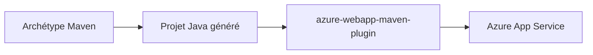

# microsoft/azure-maven-archetypes

> Maven project templates to start Java applications on Azure: Functions, IoT Edge, Spark.

## The problem
Starting a Java project that targets an Azure service means hand-building a suitable POM and structure.

## What it actually does
The repo publishes four archetypes on Maven Central, group `com.microsoft.azure`: `azure-functions-archetype`, `azure-functions-kotlin-archetype`, `azure-iot-edge-archetype`, `apache-spark-archetype`. The README does not describe their contents. It points to `azure-maven-plugins` and its `config` goal to instrument an existing POM.

## How it is wired
Simplified diagram based on the sheet, no diagram provided.


## Trying it
```bash
# Aucune commande documentée dans le README.
```

## Cost and gotchas
Java and Maven required (missing from the prerequisites list, hence `none`). An Azure account is needed to deploy. The Spark and IoT Edge archetypes are tied to platforms whose current status the README says nothing about.

## What it is not
Not an Azure SDK: the SDK archetype lives in another repo. No usage documentation here.

## Alternatives
- azure-maven-plugins: its `config` goal instruments an existing project instead of generating one.

## For you
Ignore: Java/Maven templates unrelated to data/AI work, and the README does not explain what they generate.
