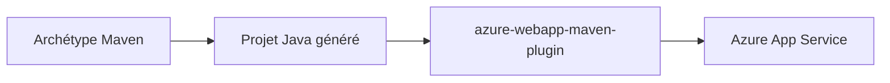

# microsoft/azure-maven-archetypes

> Modèles de projets Maven pour démarrer des applications Java sur Azure : Functions, IoT Edge, Spark.

## Le problème
Démarrer un projet Java ciblant un service Azure demande de monter à la main un POM et une structure adaptés.

## Ce que ça fait vraiment
Le dépôt publie quatre archétypes sur Maven Central, groupe `com.microsoft.azure` : `azure-functions-archetype`, `azure-functions-kotlin-archetype`, `azure-iot-edge-archetype`, `apache-spark-archetype`. Le README ne décrit pas leur contenu. Il renvoie à `azure-maven-plugins` et à son goal `config` pour instrumenter un POM existant.

## Comment c'est branché
Schéma simplifié d'après la fiche, sans diagramme fourni.


## Essayer
```bash
# Aucune commande documentée dans le README.
```

## Coût et pièges
Java et Maven requis (absents de la liste des prérequis, d'où `aucun`). Un compte Azure est nécessaire pour déployer. Les archétypes Spark et IoT Edge sont liés à des plateformes dont le README ne dit rien de l'état actuel.

## Ce que ce n'est pas
Pas un SDK Azure : l'archétype du SDK vit dans un autre dépôt. Pas de documentation d'usage ici.

## Alternatives
- azure-maven-plugins : son goal `config` instrumente un projet existant au lieu d'en générer un.

## Pour toi
À ignorer : modèles Java/Maven sans lien avec le travail data/IA, et le README n'explique pas ce qu'ils génèrent.

