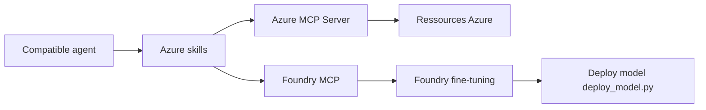

# microsoft/azure-skills

> Agent plugin that pairs Azure skills with MCP servers to act on real Azure resources.

## The problem
An agent gives generic cloud advice: it can neither choose a service, validate a deployment, nor act on your subscription.

## What it actually does
Three layers: skills (prepare, validate, deploy, diagnostics, cost, rbac, ai...), Azure MCP Server (200+ tools across 40+ services) and Foundry MCP for models and agents. Installable in Copilot CLI, VS Code, Claude Code, Gemini CLI, Cursor, Codex, IntelliJ. Also contains Foundry fine-tuning utilities.

## How it is wired


## Trying it
```bash
/plugin install azure@claude-plugins-official
az login
azd auth login
apm install microsoft/azure-skills
```

## Cost and gotchas
You need an Azure subscription, Node 18+ and Azure CLI. Actions create billed resources. To turn off telemetry: `AZURE_MCP_COLLECT_TELEMETRY=false`. Repository synced from another one (contributions happen elsewhere).

## What it is not
Not a simple set of prompts: it runs tools on your resources. It runs against the Azure cloud; sovereign clouds require configuration.

## Alternatives
No alternative named in the README.

## For you
Worth watching: interesting if you deploy AI on Azure; keep a human in the loop, since the agents act on paid resources.
