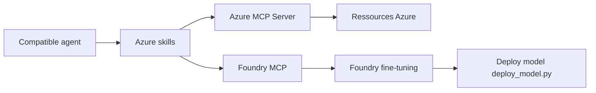

# microsoft/azure-skills

> Plugin d'agents qui associe skills Azure et serveurs MCP pour agir sur de vraies ressources Azure.

## Le problème
Un agent donne des conseils cloud génériques : il ne sait ni choisir un service, ni valider un déploiement, ni agir sur ton abonnement.

## Ce que ça fait vraiment
Trois couches : skills (prepare, validate, deploy, diagnostics, cost, rbac, ai…), Azure MCP Server (200+ outils sur 40+ services) et Foundry MCP pour les modèles et agents. Installable dans Copilot CLI, VS Code, Claude Code, Gemini CLI, Cursor, Codex, IntelliJ. Contient aussi des utilitaires de fine-tuning Foundry.

## Comment c'est branché


## Essayer
```bash
/plugin install azure@claude-plugins-official
az login
azd auth login
apm install microsoft/azure-skills
```

## Coût et pièges
Il faut un abonnement Azure, Node 18+ et Azure CLI. Les actions créent des ressources facturées. Pour couper la télémétrie : `AZURE_MCP_COLLECT_TELEMETRY=false`. Dépôt synchronisé depuis un autre (contributions ailleurs).

## Ce que ce n'est pas
Pas un simple lot de prompts : il exécute des outils sur tes ressources. Tourne contre le cloud Azure ; des clouds souverains demandent une config.

## Alternatives
Aucune alternative nommée dans le README.

## Pour toi
Surveiller : intéressant si tu déploies de l'IA sur Azure ; garde un humain dans la boucle, car les agents agissent sur des ressources payantes.

