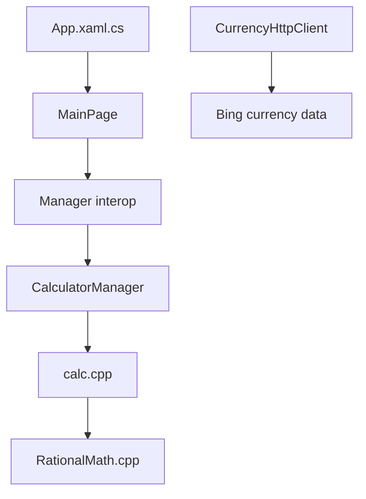

# microsoft/calculator

> Source code of the Windows Calculator, for C++/C# developers interested in a UWP application.

## The problem
Studying or contributing to the calculator shipped with Windows requires its source code.

## What it actually does
The repository contains the standard, scientific, programmer and date calculation modes, history, and unit and currency converters, with infinite precision for basic operations. The XAML views go through an interoperability layer to `CalculatorManager`, which drives the native engine (`calc.cpp`, `RationalMath.cpp`) and sends the display back by callback. The exchange rate comes from Bing, but development builds use fake data (planets instead of countries). The graphing engine is proprietary and absent: a mock version replaces it.

## How it is wired



## Trying it
```
git clone https://github.com/Microsoft/calculator.git
```
Then open `src\Calculator.slnx` in Visual Studio.

## Cost and gotchas
Free, but it requires Windows 11 build 22000+, Visual Studio with the "Universal Windows Platform Development" workload, the Windows 11 SDK and the XAML Styler extension. The official application collects diagnostic data, disabled by default in development builds.

## What it is not
It is not a calculator to run on the command line, nor cross-platform. Local builds lack the graphing and real exchange rates, whose data is not licensed for you.

## Alternatives
No alternative named in the README.

## For you
Ignore: Windows desktop application unrelated to data, AI or MLOps; read only as an example of C++/XAML architecture.
