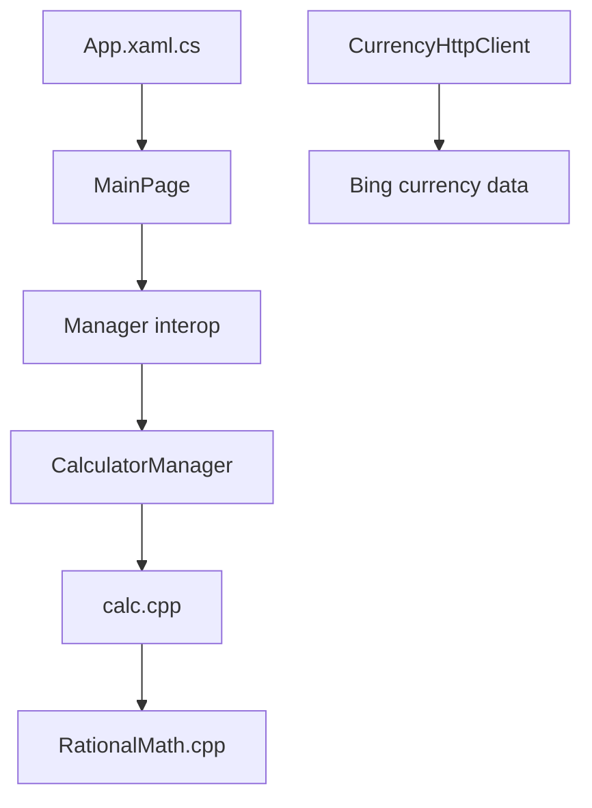

# microsoft/calculator

> Code source de la Calculatrice Windows, pour développeurs C++/C# intéressés par une application UWP.

## Le problème
Étudier ou contribuer à la calculatrice livrée avec Windows exige d'en avoir le code source.

## Ce que ça fait vraiment
Le dépôt contient les modes standard, scientifique, programmeur, calcul de dates, historique et convertisseurs d'unités et de devises, avec une précision infinie pour les opérations de base. Les vues XAML passent par une couche d'interopérabilité vers `CalculatorManager`, qui pilote le moteur natif (`calc.cpp`, `RationalMath.cpp`) et renvoie l'affichage par rappel. Le taux de change vient de Bing, mais les builds de développement utilisent des données factices (planètes à la place des pays). Le moteur de graphes est propriétaire et absent : une version factice le remplace.

## Comment c'est branché



## Essayer
```
git clone https://github.com/Microsoft/calculator.git
```
Puis ouvrir `src\Calculator.slnx` dans Visual Studio.

## Coût et pièges
Gratuit, mais il faut Windows 11 build 22000+, Visual Studio avec la charge « Universal Windows Platform Development », le SDK Windows 11 et l'extension XAML Styler. L'application officielle collecte des données de diagnostic, désactivées par défaut dans les builds de développement.

## Ce que ce n'est pas
Ce n'est pas une calculatrice à lancer en ligne de commande, ni multiplateforme. Les builds locaux n'ont pas le graphe ni les vrais taux de change, dont les données ne sont pas licenciées pour toi.

## Alternatives
Aucune alternative nommée dans le README.

## Pour toi
À ignorer : application Windows de bureau sans rapport avec la data, l'IA ou le MLOps ; à lire seulement comme exemple d'architecture C++/XAML.

