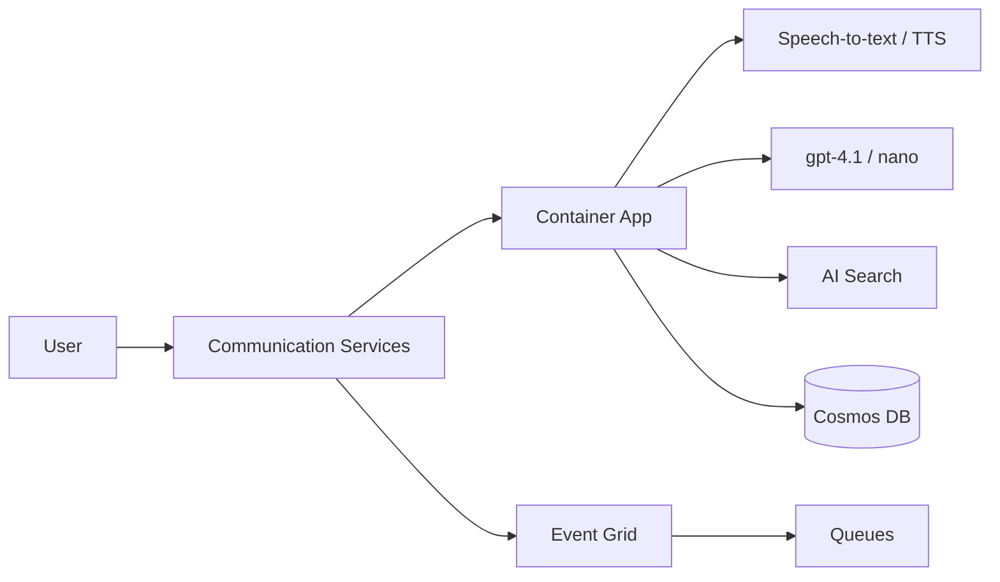

# microsoft/call-center-ai

> Proof of concept of an AI voice call center on Azure and GPT, for cloud teams.

## The problem
Automating phone calls (inbound/outbound) with understanding, data collection and human handoff requires assembling many services.

## What it actually does
A `POST /call` starts a call; the conversation goes through STT, GPT-4.1/nano, streaming TTS via Azure Communication Services.
Fills a "claim" according to a configurable schema, creates reminders and a summary, stored in Cosmos DB.
RAG on Azure AI Search, Redis cache, Azure Storage queues, Event Grid; transfer to a human agent.
Feature flags via App Configuration, traces in Application Insights.

## How it is wired


## Trying it
```bash
az login
make deploy name=my-rg-name
make logs name=my-rg-name
make deploy-bicep deploy-post name=my-rg-name
make tunnel
make dev
python3 -m tests.local
```

## Cost and gotchas
About $720/month estimated for 1000 calls of 10 minutes, plus ~$343 optional (monitoring); phone number to buy.
Entirely tied to Azure.

## What it is not
Not production-ready: the README says so and lists what is missing (private networking, multi-region…).
Not portable outside Azure.

## Alternatives
- VoiceRAG: simpler example with gpt-4o-realtime, local.
- Realtime Call Center Solution Accelerator: easier to deploy on Azure.

## For you
Watch if you work on Azure: well-documented voice + RAG reference architecture, with honest cost estimates.
