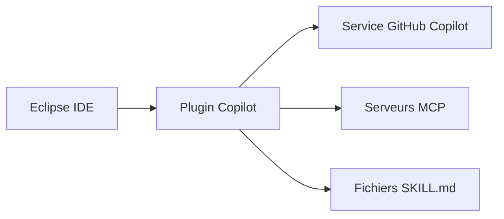

# microsoft/copilot-for-eclipse

> GitHub Copilot plugin for the Eclipse IDE: completions, agent mode and MCP, for Eclipse developers.

## The problem
Eclipse users have no AI code assistant built into their IDE, unlike other editors.

## What it actually does
Inline completions, next edit suggestions, Ask and Agent modes, MCP integration, custom agents, isolated sub-agents, a plan agent and skills defined by `SKILL.md` files. Everything goes through a GitHub Copilot subscription; the plugin sends usage data to Microsoft.

## How it is wired
Simplified diagram based on the sheet, no diagram provided.



## Trying it
Install through the Eclipse Marketplace (drag Install), or through Help > Install New Software with the update site URL given in the README:

```bash
https://azuredownloads-g3ahgwb5b8bkbxhd.b01.azurefd.net/github-copilot/
```

## Cost and gotchas
An active Copilot subscription is required (a Free tier exists). From 0.23.0 on: Eclipse 2025-12 (4.38) and Java 21 to run Eclipse. 190 open issues.

## What it is not
Not a standalone tool: the plugin code is open, the service is not. It is not a model you host.

## Alternatives
No alternative named in the README.

## For you
Ignore unless you code in Eclipse: it is a client for a paid, telemetry-enabled service, with no interest of its own for a data or MLOps profile.
