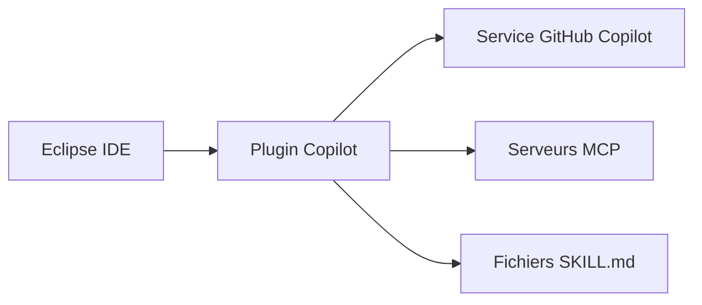

# microsoft/copilot-for-eclipse

> Plugin GitHub Copilot pour l'IDE Eclipse : complétions, mode agent et MCP, pour les développeurs Eclipse.

## Le problème
Les utilisateurs d'Eclipse n'ont pas d'assistant de code IA intégré à leur IDE, contrairement à d'autres éditeurs.

## Ce que ça fait vraiment
Complétions en ligne, suggestions de prochaine modification, modes Ask et Agent, intégration MCP, agents personnalisés, sous-agents isolés, agent de plan et skills définis par des fichiers `SKILL.md`. Tout passe par un abonnement GitHub Copilot ; le plugin envoie des données d'usage à Microsoft.

## Comment c'est branché
Schéma simplifié d'après la fiche, sans diagramme fourni.



## Essayer
Installation par le Marketplace Eclipse (glisser Install), ou par Help > Install New Software avec l'URL de site de mise à jour donnée dans le README :

```bash
https://azuredownloads-g3ahgwb5b8bkbxhd.b01.azurefd.net/github-copilot/
```

## Coût et pièges
Abonnement Copilot actif requis (une offre Free existe). À partir de la 0.23.0 : Eclipse 2025-12 (4.38) et Java 21 pour lancer Eclipse. 190 issues ouvertes.

## Ce que ce n'est pas
Pas un outil autonome : le code du plugin est ouvert, le service ne l'est pas. Ce n'est pas un modèle que tu héberges.

## Alternatives
Aucune alternative nommée dans le README.

## Pour toi
Ignorer sauf si tu codes sous Eclipse : c'est un client pour un service payant et à télémétrie, sans intérêt propre pour un profil data ou MLOps.

