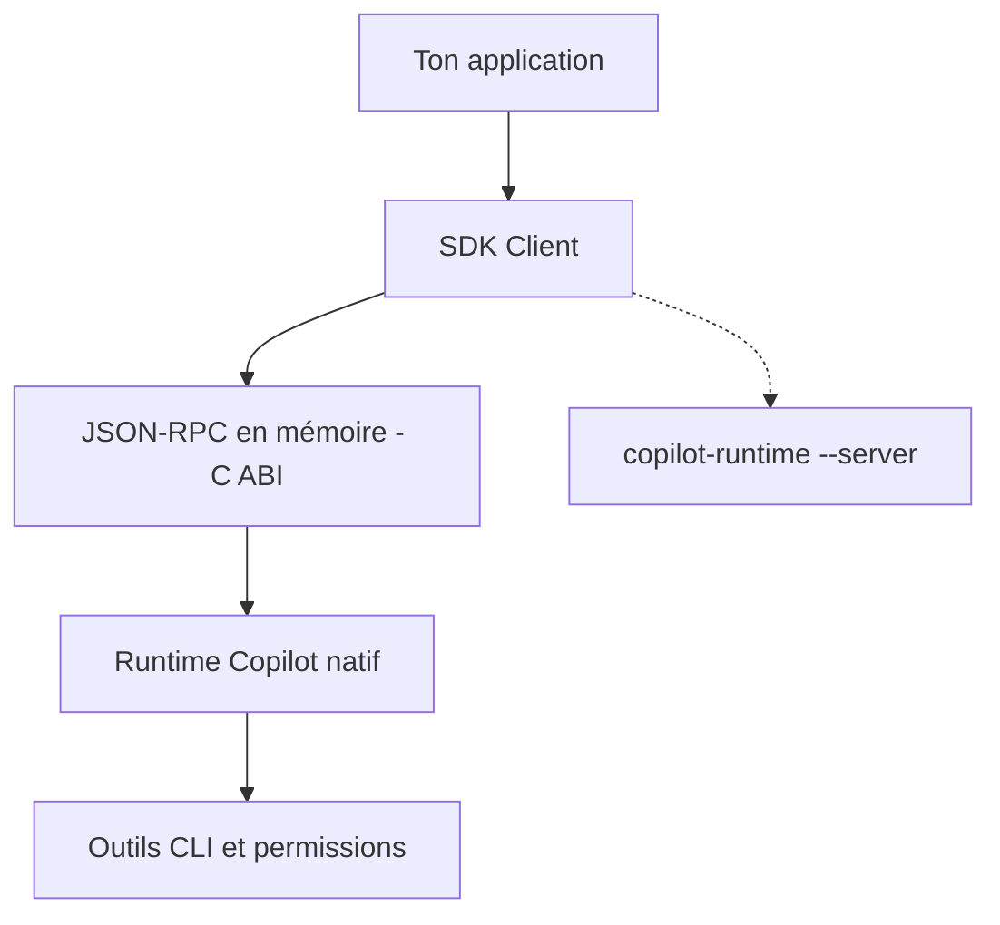

# microsoft/copilot-sdk

> Multi-language SDK to embed the Copilot CLI agent engine in your own applications.

## The problem
Building your own agent orchestration (planning, tool calls, file editing) takes a long time.

## What it actually does
Exposes the Copilot CLI agent runtime in Python, TypeScript, Go, .NET, Rust and Java. The SDKs drive a native runtime over JSON-RPC, in memory by default or through a child process or a standalone server. You can define custom agents, skills and tools; execution permissions go through a handler on the application side.

## How it is wired


## Trying it
```bash
pip install microsoft-copilot-sdk
npm install @microsoft/copilot-sdk
go get github.com/microsoft/copilot-sdk/go/v2
dotnet add package Microsoft.Copilot.SDK
cargo add copilot-sdk
```

## Cost and gotchas
A GitHub Copilot subscription is required, except in BYOK with your own keys. Each prompt counts against the quota, like the CLI. The repository is migrating from GitHub to Microsoft: some package names may still say GitHub. In-process loading offers no crash isolation or sandbox; the CLI tools are exposed by default.

## What it is not
Not a generic, provider-independent agent SDK: it is tied to the Copilot runtime. Not a simple model API client.

## Alternatives
No alternative named in the README.

## For you
Worth watching if you want a ready-made agent engine inside an internal app; the link with Copilot and its billing decides the choice.
