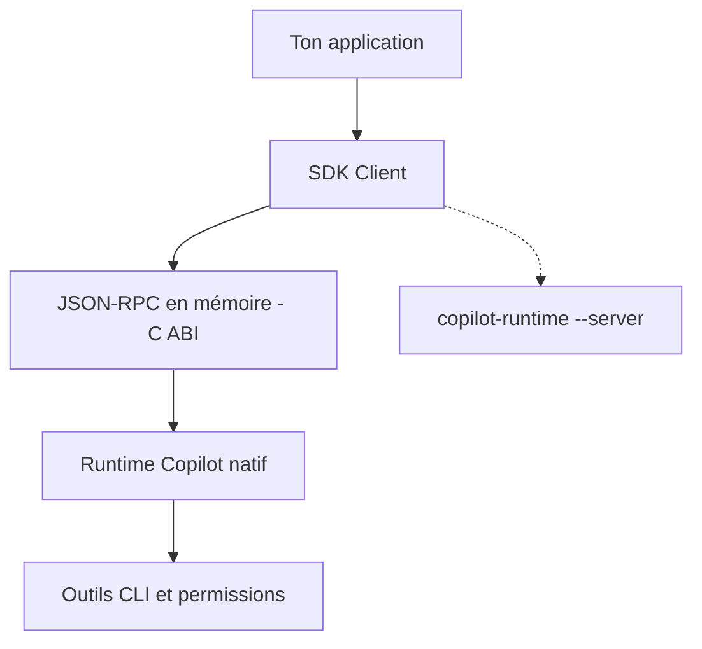

# microsoft/copilot-sdk

> SDK multi-langages pour embarquer le moteur d'agent de Copilot CLI dans ses propres applications.

## Le problème
Construire sa propre orchestration d'agent (planification, appels d'outils, édition de fichiers) est long.

## Ce que ça fait vraiment
Expose le runtime d'agent de Copilot CLI en Python, TypeScript, Go, .NET, Rust et Java. Les SDK pilotent un runtime natif par JSON-RPC, en mémoire par défaut ou via un processus fils ou un serveur autonome. On peut définir des agents, skills et outils personnalisés ; les permissions d'exécution passent par un gestionnaire côté application.

## Comment c'est branché


## Essayer
```bash
pip install microsoft-copilot-sdk
npm install @microsoft/copilot-sdk
go get github.com/microsoft/copilot-sdk/go/v2
dotnet add package Microsoft.Copilot.SDK
cargo add copilot-sdk
```

## Coût et pièges
Un abonnement GitHub Copilot est requis, sauf en BYOK avec tes propres clés. Chaque prompt compte dans le quota, comme la CLI. Le dépôt migre de GitHub vers Microsoft : des noms de paquets peuvent encore dire GitHub. Le chargement en processus n'offre ni isolation de crash ni sandbox ; les outils CLI sont exposés par défaut.

## Ce que ce n'est pas
Pas un SDK d'agent générique indépendant du fournisseur : il est lié au runtime Copilot. Pas un simple client d'API de modèles.

## Alternatives
Aucune alternative nommée dans le README.

## Pour toi
À surveiller si tu veux un moteur d'agent prêt à l'emploi dans une app interne ; le lien avec Copilot et sa facturation décide du choix.

