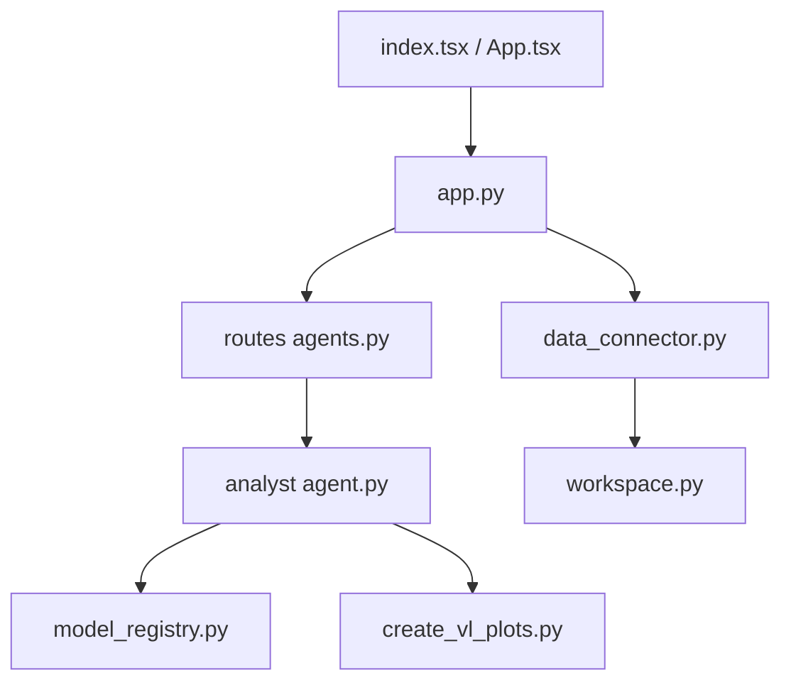

# microsoft/data-formulator

> Local workspace where an AI agent explores data and produces editable charts.

## The problem
Data is scattered across files, databases and warehouses. And a long conversation makes you lose track of an exploration that branches in several directions.

## What it actually does
You load CSV, Excel, JSON files, screenshots or text, or connect to PostgreSQL, BigQuery, Databricks, Kusto, S3.
"Data Threads" let you restart from any step to try a different analysis.
The agent generates Flint/Vega-Lite charts in a sandbox, then assembles a report.
OpenAI, Azure, Ollama and Anthropic models go through LiteLLM. The API is in Python, the interface in React.

## How it is wired


## Trying it
```bash
uvx data_formulator
pip install data_formulator
python -m data_formulator
docker compose up --build
```

## Cost and gotchas
The LLM provider is at your expense, unless you use Ollama. Desktop builds are not signed.

## What it is not
It is not a team BI tool with governance: it is a Microsoft research project, local first. It does not replace a notebook for reproducible analyses.

## Alternatives
The README names no alternative repository. It only cites Flint, its charting engine.

## For you
Adopt: a one-line `uvx` install, connectors to your sources and a possible local LLM. A good EDA accelerator to try right away.
