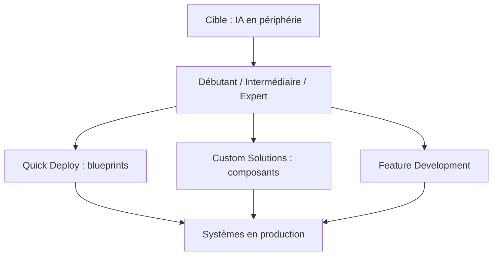

# microsoft/edge-ai

> Terraform and Bicep infrastructure templates for deploying AI at the edge on Azure; for platform teams.

## The problem
Setting up an edge infrastructure (Kubernetes, IoT, inference) connected to the cloud requires assembling many building blocks.

## What it actually does
Provides reusable components in `src/` (identity, data, messaging, observability, Kubernetes, Azure IoT Operations, AI inference) and deployment plans in `blueprints/` (single node, cluster, cloud only, minimal). The repository also brings agents and instructions for GitHub Copilot, usable from a dev container.

## How it is wired


## Trying it
```bash
git clone https://github.com/Microsoft/edge-ai.git
cd edge-ai
code .
# puis "Reopen in Container"
```

## Cost and gotchas
Azure resources billed to you, plus VS Code, Docker and Copilot for the recommended path. Microsoft telemetry when using Terraform, can be disabled with `ARM_DISABLE_TERRAFORM_PARTNER_ID=true`.

## What it is not
Not an AI framework nor a model: it is infrastructure. The announced durations (30-60 minutes) are not verified.

## Alternatives
None named in the README.

## For you
Watch: useful if you need to deploy inference on Azure edge sites, useless outside this ecosystem.
