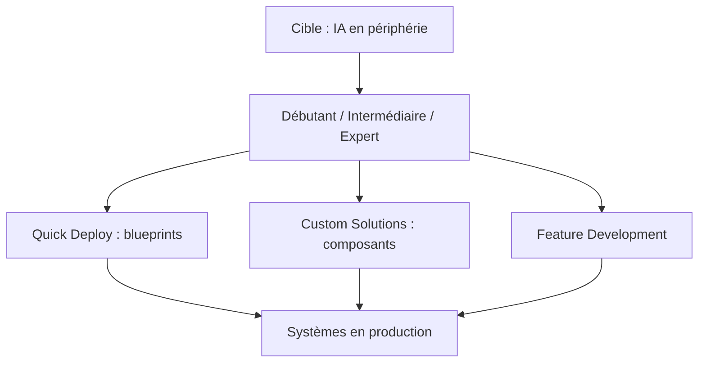

# microsoft/edge-ai

> Modèles d'infrastructure Terraform et Bicep pour déployer de l'IA en périphérie sur Azure ; pour équipes plateforme.

## Le problème
Monter une infrastructure edge (Kubernetes, IoT, inférence) reliée au cloud demande d'assembler beaucoup de briques.

## Ce que ça fait vraiment
Fournit des composants réutilisables dans `src/` (identité, données, messagerie, observabilité, Kubernetes, Azure IoT Operations, inférence IA) et des plans de déploiement dans `blueprints/` (nœud unique, cluster, cloud seul, minimal). Le dépôt apporte aussi des agents et instructions pour GitHub Copilot, utilisables depuis un dev container.

## Comment c'est branché


## Essayer
```bash
git clone https://github.com/Microsoft/edge-ai.git
cd edge-ai
code .
# puis "Reopen in Container"
```

## Coût et pièges
Ressources Azure facturées à ta charge, plus VS Code, Docker et Copilot pour le chemin recommandé. Télémétrie Microsoft à l'usage de Terraform, désactivable avec `ARM_DISABLE_TERRAFORM_PARTNER_ID=true`.

## Ce que ce n'est pas
Pas un framework d'IA ni un modèle : c'est de l'infrastructure. Les durées annoncées (30-60 minutes) ne sont pas vérifiées.

## Alternatives
Aucune nommée dans le README.

## Pour toi
Surveiller : utile si tu dois déployer de l'inférence sur des sites edge Azure, inutile hors de cet écosystème.

