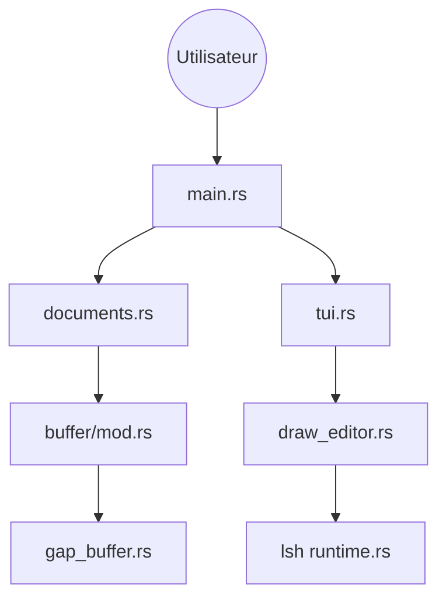

# microsoft/edit

> Terminal text editor inspired by MS-DOS Editor, for users unfamiliar with the terminal.

## The problem
Editing a file over SSH or in a console often means learning vim or nano, which are not beginner-friendly.

## What it actually does
Terminal editor written in Rust, with shortcuts close to VS Code. It handles a Unicode buffer (gap buffer), search and replace, clipboard, a file picker, syntax highlighting via the `lsh` crate, and localization. ICU is an optional dependency for search and replace.

## How it is wired


## Trying it
```bash
winget install Microsoft.Edit
brew install msedit
curl --proto '=https' --tlsv1.2 -sSf https://raw.githubusercontent.com/microsoft/edit/main/assets/install.sh | sh
cargo build --release
```

## Cost and gotchas
Free. On Linux, the script install compiles from source: you need Rust, a C compiler, ICU and curl/tar. The name `edit` may conflict with existing commands, hence `msedit`.

## What it is not
Not an IDE: no completion or extensions described in the README. It aims for simplicity, not the power of vim or Emacs.

## Alternatives
- dail8859/NotepadNext: graphical editor, not in the terminal.

## For you
Watch: handy for editing a config file on a server without learning vim, but it does not replace your working editor.
