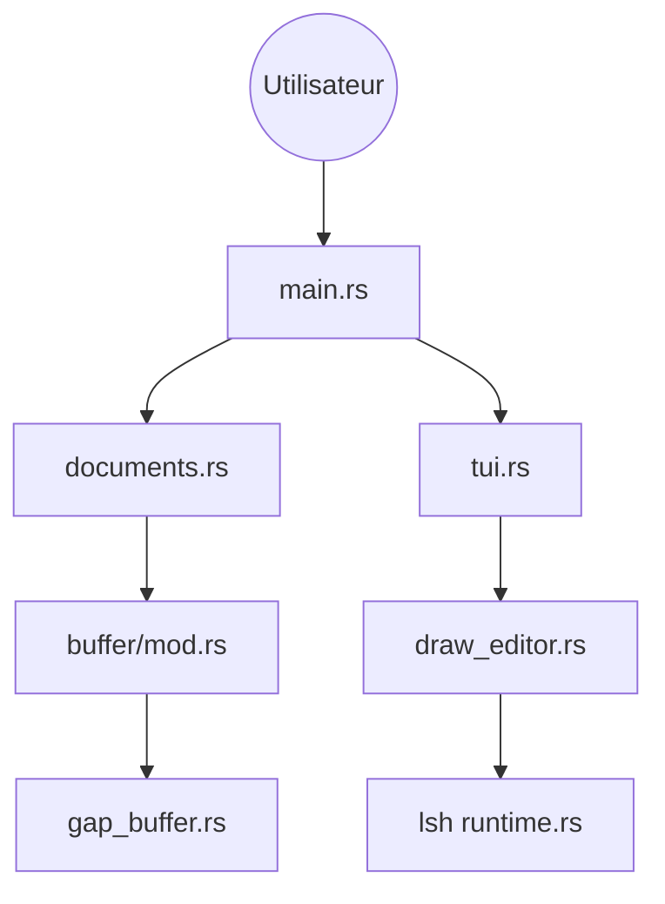

# microsoft/edit

> Éditeur de texte en terminal, inspiré de MS-DOS Editor, pour des utilisateurs peu familiers du terminal.

## Le problème
Éditer un fichier en SSH ou en console oblige souvent à apprendre vim ou nano, peu accessibles au débutant.

## Ce que ça fait vraiment
Éditeur en terminal écrit en Rust, aux raccourcis proches de VS Code. Il gère un tampon Unicode (gap buffer), la recherche et le remplacement, le presse-papiers, un sélecteur de fichiers, la coloration syntaxique via la crate `lsh`, et la localisation. ICU est une dépendance optionnelle pour la recherche et le remplacement.

## Comment c'est branché


## Essayer
```bash
winget install Microsoft.Edit
brew install msedit
curl --proto '=https' --tlsv1.2 -sSf https://raw.githubusercontent.com/microsoft/edit/main/assets/install.sh | sh
cargo build --release
```

## Coût et pièges
Gratuit. Sous Linux, l'installation par script compile depuis les sources : il faut Rust, un compilateur C, ICU et curl/tar. Le nom `edit` peut entrer en conflit avec des commandes existantes, d'où `msedit`.

## Ce que ce n'est pas
Pas un IDE : pas de complétion ni d'extensions décrites dans le README. Il vise la simplicité, pas la puissance de vim ou d'Emacs.

## Alternatives
- dail8859/NotepadNext : éditeur graphique, pas en terminal.

## Pour toi
À surveiller : pratique pour éditer un fichier de config sur un serveur sans apprendre vim, mais il ne remplace pas ton éditeur de travail.

