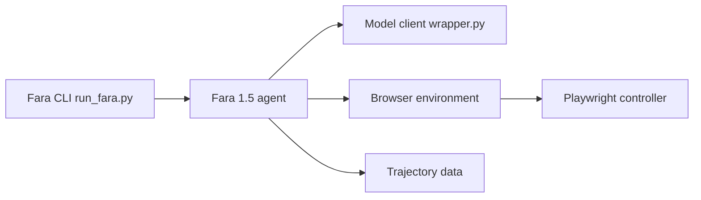

# microsoft/fara

> Fara1.5 model family (4B, 9B, 27B) that drives a browser from screenshots.

## The problem
Web agents often rely on accessibility trees and separate parsing models.

## What it actually does
Observe-think-act loop: the model receives a screenshot and directly predicts clicks, typing and web searches. The repository contains the `fara-cli` CLI, a Playwright controller, the `webeval` evaluation framework (WebTailBench) and the Universal Verifier. The models are on Microsoft Foundry or local with vLLM.

## How it is wired


## Trying it
```bash
git clone https://github.com/microsoft/fara.git
cd fara
python3 -m venv .venv
source .venv/bin/activate
pip install -e .
playwright install
fara-cli --task "whats the weather in new york now" --endpoint_config azure_foundry_config.json
```

## Cost and gotchas
Paid Foundry endpoint at your expense, or a GPU for vLLM (context ≥ 15,000 tokens, temperature 0). "Research preview": run it in a sandbox, without sensitive data.

## What it is not
Not a finished product. The documented `webeval` pipeline corresponds to Fara-7B and is being updated.

## Alternatives
Compare with OpenAI Operator, Gemini 2.5 Computer Use and GPT-5 SoM in its benchmarks.

## For you
Worth watching: a useful reference for experimenting with computer-use agents using small local models, but still a preview.
