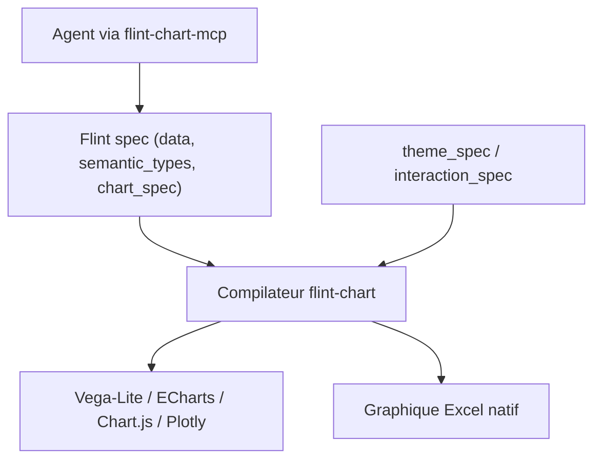

# microsoft/flint-chart

> Chart specification language that an AI agent compiles to Vega-Lite, ECharts, Chart.js, Plotly or Excel.

## The problem
An agent that writes Vega-Lite or Plotly code directly produces fragile, ugly or non-interactive charts, and the syntax changes from one engine to another.

## What it actually does
A short specification (data, semantic types, chart type, theme, interactions) that the compiler turns into a native specification. 52 chart types, 5 engines, 14 themes, 23 interaction presets. Available as an MCP server (local or hosted) and as an npm library with a React component.

## How it is wired
Simplified diagram based on the sheet, no diagram provided.



## Trying it
```bash
npx -y flint-chart-mcp
npm install flint-chart
```

## Cost and gotchas
Free; the hosted MCP server (flint.data-formulator.ai) sends your request to a third-party service, so prefer the local version for sensitive data. The Python port is not published.

## What it is not
Not a BI tool or a rendering engine: it compiles to existing engines, which you must install. No guarantee for charts outside the catalogued types.

## Alternatives
Vega-Lite, ECharts, Chart.js and Plotly, which Flint compiles to; use them directly if you want full control.

## For you
Adopt for your analysis agents: a single readable, editable spec gives consistent charts, with an MCP ready to plug into Claude Code.
