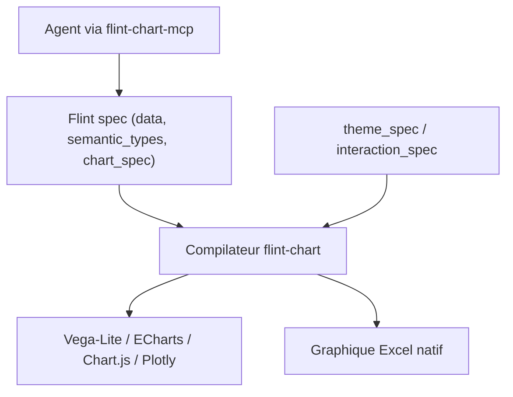

# microsoft/flint-chart

> Langage de spécification de graphiques qu'un agent IA compile vers Vega-Lite, ECharts, Chart.js, Plotly ou Excel.

## Le problème
Un agent qui écrit directement du code Vega-Lite ou Plotly produit des graphiques fragiles, laids ou non interactifs, et change de syntaxe selon le moteur.

## Ce que ça fait vraiment
Une spécification courte (données, types sémantiques, type de graphique, thème, interactions) que le compilateur transforme en spécification native. 52 types de graphiques, 5 moteurs, 14 thèmes, 23 préréglages d'interaction. Disponible en serveur MCP (local ou hébergé) et en bibliothèque npm avec composant React.

## Comment c'est branché
Schéma simplifié d'après la fiche, sans diagramme fourni.



## Essayer
```bash
npx -y flint-chart-mcp
npm install flint-chart
```

## Coût et pièges
Gratuit ; le serveur MCP hébergé (flint.data-formulator.ai) envoie ta demande à un service tiers, préférer la version locale pour des données sensibles. Le portage Python n'est pas publié.

## Ce que ce n'est pas
Pas un outil de BI ni un moteur de rendu : il compile vers des moteurs existants, qu'il faut installer. Pas de garantie sur les graphiques hors types catalogués.

## Alternatives
Vega-Lite, ECharts, Chart.js et Plotly, que Flint compile ; à utiliser directement si tu veux un contrôle total.

## Pour toi
À adopter pour tes agents d'analyse : une seule spec lisible et éditable donne des graphiques cohérents, avec un MCP prêt à brancher dans Claude Code.

