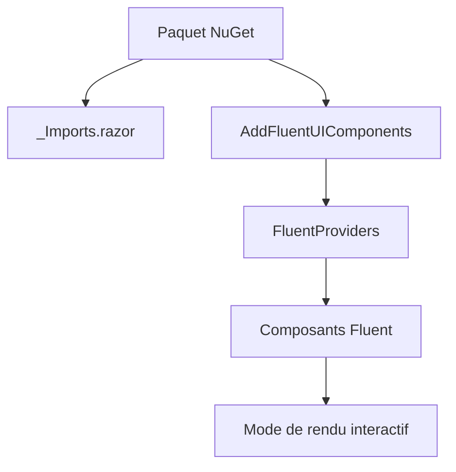

# microsoft/fluentui-blazor

> Blazor component library in Microsoft's Fluent style, for .NET developers.

## The problem
Giving a Blazor application the look of modern Microsoft applications without writing the components yourself.

## What it actually does
The `Microsoft.FluentUI.AspNetCore.Components` package provides Blazor components, some of which wrap the official Fluent UI Web Components. Project templates (Web App, WebAssembly, Aspire, MAUI) preconfigure services and styles. Separate packages provide icons and emojis. The README describes version 5, developed on the `dev` branch.

## How it is wired
Simplified diagram based on the fiche, no diagram provided.


## Trying it
```bash
dotnet new install Microsoft.FluentUI.AspNetCore.Templates
dotnet new fluentuiblazor -o MyApplication
dotnet add package Microsoft.FluentUI.AspNetCore.Components
```

## Cost and gotchas
Free. Requires the .NET SDK and an interactive render mode. Moving from v4 to v5 involves breaking changes.

## What it is not
Not a standalone UI framework: it assumes Blazor. It is not a tool for data dashboards.

## Alternatives
No alternative named in the README.

## For you
Ignore: only useful if you build a Blazor interface, which falls outside the data and AI scope.
