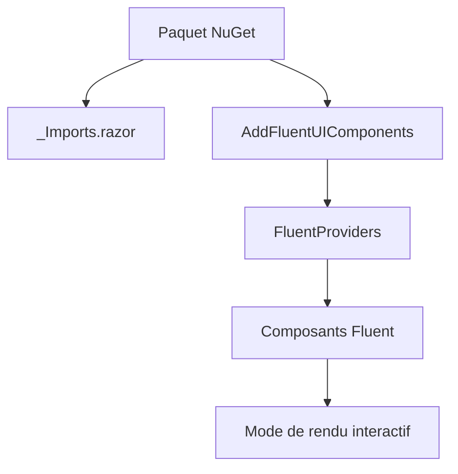

# microsoft/fluentui-blazor

> Bibliothèque de composants Blazor au style Fluent de Microsoft, pour développeurs .NET.

## Le problème
Donner à une application Blazor l'apparence des applications Microsoft modernes sans écrire les composants soi-même.

## Ce que ça fait vraiment
Le paquet `Microsoft.FluentUI.AspNetCore.Components` fournit des composants Blazor, dont certains enveloppent les Fluent UI Web Components officiels. Des modèles de projet (Web App, WebAssembly, Aspire, MAUI) préconfigurent services et styles. Des paquets séparés fournissent icônes et emojis. Le README décrit la version 5, développée sur la branche `dev`.

## Comment c'est branché
Schéma simplifié d'après la fiche, sans diagramme fourni.


## Essayer
```bash
dotnet new install Microsoft.FluentUI.AspNetCore.Templates
dotnet new fluentuiblazor -o MyApplication
dotnet add package Microsoft.FluentUI.AspNetCore.Components
```

## Coût et pièges
Gratuit. Il faut le SDK .NET et un mode de rendu interactif. Passage de la v4 à la v5 avec changements cassants.

## Ce que ce n'est pas
Pas un framework d'interface autonome : il suppose Blazor. Ce n'est pas un outil pour dashboards de données.

## Alternatives
Aucune alternative nommée dans le README.

## Pour toi
Ignorer : utile uniquement si tu construis une interface Blazor, ce qui sort du périmètre data et IA.

