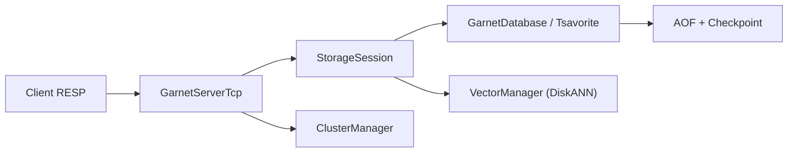

# microsoft/garnet

> Remote cache-store compatible with Redis's RESP protocol, written in .NET, for high-load apps.

## The problem
A Redis-style cache hits a throughput ceiling with many connections and small batches, and gets expensive at scale.

## What it actually does
A server that speaks RESP: unmodified Redis clients connect to it. The TCP server parses and dispatches commands; the Tsavorite storage layer (main store for strings, optional object store for complex types) handles checkpoints, AOF journal, and tiered storage. Extensible in C# (procedures, modules) and Lua. Passive cluster mode (no leader election). Preview: Vector Sets (DiskANN) and Range Index.

## How it is wired

## Trying it
No command in the README; it points to the documentation site (getting started).

## Cost and gotchas
Free. The cluster requires a control plane supplied by the user. Managed version: Azure Cosmos DB Garnet Cache (paid).

## What it is not
Not Redis: protocol compatibility, not guaranteed for every command. Latency figures come from the README, on Azure VMs.

## Alternatives
None named, apart from Redis (the compatibility target).

## For you
Worth watching for a lightweight cache or vector store, but Vector Sets are in preview: do not depend on them in production.
