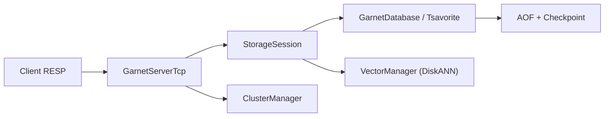

# microsoft/garnet

> Cache-store distant compatible protocole RESP de Redis, écrit en .NET, pour apps à forte charge.

## Le problème
Un cache de type Redis plafonne en débit avec beaucoup de connexions et petits lots, et coûte cher à grande échelle.

## Ce que ça fait vraiment
Serveur qui parle RESP : les clients Redis non modifiés se connectent. Le TCP server parse et dispatche les commandes ; le stockage Tsavorite (main store pour chaînes, object store optionnel pour types complexes) gère checkpoints, journal AOF, stockage hiérarchisé. Extensible en C# (procédures, modules) et Lua. Mode cluster passif (sans élection de leader). Aperçu : Vector Sets (DiskANN) et Range Index.

## Comment c'est branché

## Essayer
Aucune commande dans le README ; renvoi au site de documentation (getting started).

## Coût et pièges
Gratuit. Le cluster exige un plan de contrôle fourni par l'utilisateur. Version managée : Azure Cosmos DB Garnet Cache (payante).

## Ce que ce n'est pas
Pas Redis : compatibilité de protocole, non garantie sur toutes les commandes. Les chiffres de latence viennent du README, sur VM Azure.

## Alternatives
Aucune nommée, hors Redis (cible de compatibilité).

## Pour toi
À surveiller pour un cache ou un magasin de vecteurs léger, mais les Vector Sets sont en préversion : ne pas en dépendre en production.

