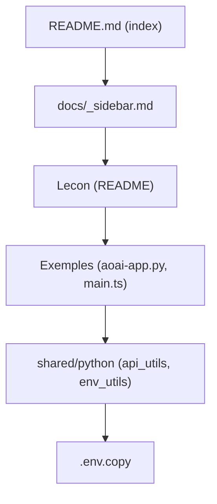

# microsoft/generative-ai-for-beginners

> A 21-lesson course on Microsoft, teaching you how to build generative AI applications using Python and TypeScript.

## The problem
Starting with generative AI without a structured approach leads to fragmented tutorials, often tied to a single provider.

## What it actually does
Each lesson is a README ("Learn" or "Build") with examples in Python and TypeScript: LLMs, prompts, text generation, chat, vector search, images, low-code, function calling, UX, security, LLMOps lifecycle, RAG, open-source models, agents, fine-tuning, SLM, Mistral, Meta. The examples run on Azure OpenAI, OpenAI, Foundry, or Foundry Local.

## How it is wired


## Trying it
```bash
git clone --filter=blob:none --sparse https://github.com/microsoft/generative-ai-for-beginners.git
cd generative-ai-for-beginners
git sparse-checkout set --no-cone '/*' '!translations' '!translated_images'
```

## Cost and gotchas
These examples require an Azure OpenAI, OpenAI, or Foundry API key (paid depending on usage), and a GitHub account. GitHub Models is announced to be discontinued at the end of July 2026. Cloning the entire repository is resource-intensive (over 50 translations).

## What it is not
This is not a reusable library or an app: the examples are duplicated by each vendor and are isolated. Several videos are still labeled "Coming Soon".

## Alternatives
No alternative is specified in the README (it refers to other Microsoft courses: LangChain, .NET version).

## For you
To be used as a training reference: covers RAG, agents, fine-tuning, and LLMOps in a single curriculum, useful for onboarding a team.
