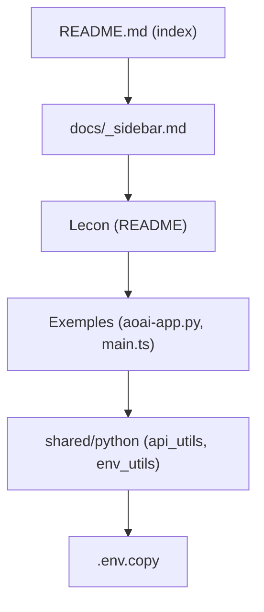

# microsoft/generative-ai-for-beginners

> Cours de 21 leçons de Microsoft pour apprendre à construire des applications d'IA générative en Python et TypeScript.

## Le problème
Débuter en IA générative sans parcours structuré mène à des tutoriels disparates, liés à un seul fournisseur.

## Ce que ça fait vraiment
Chaque leçon est un README (« Learn » ou « Build ») avec exemples en Python et TypeScript : LLM, prompts, génération de texte, chat, recherche vectorielle, images, low code, function calling, UX, sécurité, cycle de vie LLMOps, RAG, modèles open source, agents, fine-tuning, SLM, Mistral, Meta. Les exemples tournent sur Azure OpenAI, OpenAI, Foundry ou Foundry Local.

## Comment c'est branché


## Essayer
```bash
git clone --filter=blob:none --sparse https://github.com/microsoft/generative-ai-for-beginners.git
cd generative-ai-for-beginners
git sparse-checkout set --no-cone '/*' '!translations' '!translated_images'
```

## Coût et pièges
Les exemples exigent une clé Azure OpenAI, OpenAI ou Foundry (payant selon usage) et un compte GitHub. GitHub Models est annoncé retiré fin juillet 2026. Cloner tout le dépôt est lourd (50+ traductions).

## Ce que ce n'est pas
Pas une bibliothèque réutilisable ni une appli : les exemples sont dupliqués par fournisseur, isolés. Plusieurs vidéos sont encore « Coming Soon ».

## Alternatives
Aucune alternative nommée dans le README (renvoie à d'autres cours Microsoft : LangChain, version .NET).

## Pour toi
À adopter comme référence de formation : couvre RAG, agents, fine-tuning et LLMOps d'un seul parcours, utile pour onboarder une équipe.

