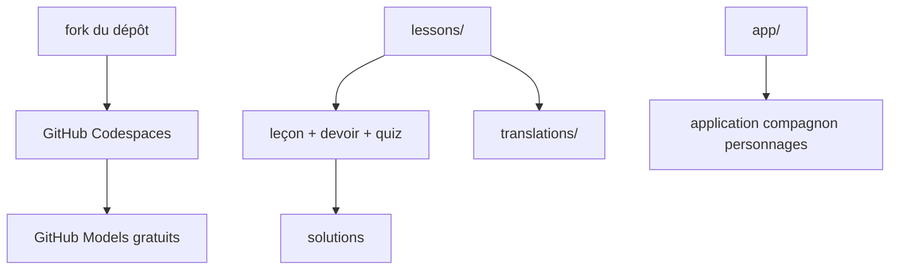

# microsoft/generative-ai-with-javascript

> Eight-lesson course on generative AI for beginner JavaScript developers.

## The problem
Nearly all LLM resources assume Python, leaving a JavaScript developer with no way in.
Setting up an environment to try a model is already an obstacle before the first line of code.

## What it actually does
Eight progressive lessons: LLM fundamentals, a first application, prompt engineering, structured output, RAG, tool calling, MCP, then MCP clients enhanced by an LLM.
Each lesson has a text, an assignment, a quiz, the solutions and a short video.
A companion app lets you chat with historical characters, on a time-travel storyline.
A series of ten video sessions completes the whole, with slides, demos and scripts (LangChain.js, Ollama, Phi-3, Azure AI Foundry, Cosmos DB, AI Chat Protocol).

## How it is wired

## Trying it
No documented command: the path goes through the **Fork** button, then the **Codespaces** tab and **Create codespace**.

## Cost and gotchas
Codespaces and GitHub Models let you follow the course without a key or a bill, but require a GitHub account.
The examples also run locally, though the README does not detail the setup needed.

## What it is not
Not an advanced course: the title announces "for beginners" and the content aims at discovery.
Not a factual source: the repository contains fictional AI-generated content, and the historical characters do not express real positions.
Not a Python course: all the code is in JavaScript.

## Alternatives
- Generative AI for Beginners: the general-purpose version of the same curriculum.
- Generative AI for Beginners .NET: the .NET variant, if that is your stack.
- AI Agents for Beginners: the logical next step if the goal is agents rather than raw LLMs.

## For you
Nothing to learn here for an experienced data / AI profile; useful only to guide a front-end developer who is starting out.
