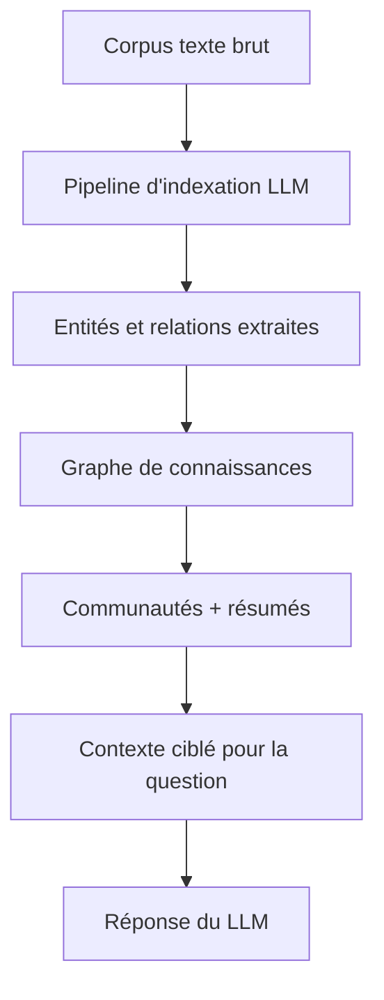

# microsoft/graphrag

> Pipeline that extracts a knowledge graph from a text corpus to feed an LLM.

## The problem
A classic vector RAG answers poorly questions that require aggregating facts scattered across a whole corpus.
Without structure, the model sees only isolated chunks, never the big picture.

## What it actually does
Transformation suite that extracts structured data from unstructured text using an LLM.
Builds knowledge-graph memory structures, then used as targeted context for the question asked.
Provides a command-line start (`graphrag init`), a prompt-tuning guide and a migration notebook between major versions.
The repository has been explicitly in maintenance mode since the warning at the top of the README: bug and dependency fixes, no new features and no PRs accepted.

## How it is wired


## Trying it
```bash
graphrag init --root [path] --force
```

## Cost and gotchas
The README itself warns: GraphRAG indexing is an expensive operation, to be read in full before launching, and to start small.
LLM API key at your expense; `graphrag init --force` overwrites configuration and prompts, so back them up first.

## What it is not
It is not a supported Microsoft product: the README presents it as a methodology demonstration, not an official offering.
It is not an active project: maintenance mode is assumed, no new features.
It is not usable as is on your data: the README recommends tuning the prompts before hoping for good results.

## Alternatives
No alternative is named in the README.

## For you
Worth knowing as a methodological reference for graph-based RAG, not to put into production in 2026.
