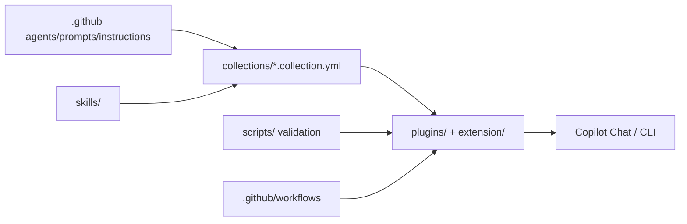

# microsoft/hve-core

> Library of agents, prompts and instructions for GitHub Copilot, structured around the Research, Plan, Implement, Review cycle.

## The problem
Each team reinvents its prompts and conventions for Copilot, with no shared standards or validation.

## What it actually does
A content repository (not an application): specialized agents, prompts, coding instructions and skills grouped into collections and packaged as VS Code extensions and as a plugin for Copilot CLI. It has an RPI method, agents for GitHub, Azure DevOps and Jira, a validation chain built from PowerShell scripts, and a Docusaurus site.

## How it is wired


## Trying it
```bash
copilot plugin marketplace add microsoft/hve-core
copilot plugin install hve-core@hve-core
```

## Cost and gotchas
The repository is free; usage assumes GitHub Copilot (subscription not specified in the README). Some skills derived from OWASP are under CC BY-SA 4.0.

## What it is not
The README warns: a very opinionated and evolving framework, to be treated as a source of patterns, not as a stable platform or a production dependency. Breaking changes are announced.

## Alternatives
No alternative named in the README.

## For you
Worth watching: prompt and agentic workflow patterns to copy, but not to adopt as a dependency.
