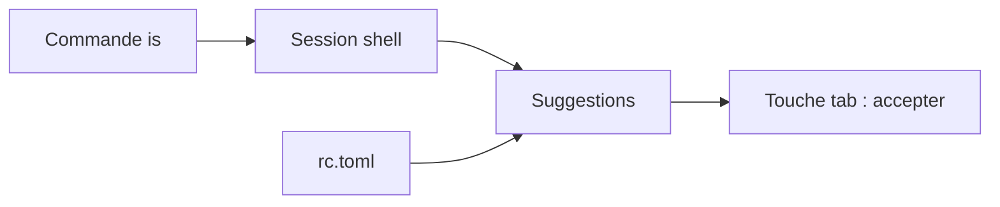

# microsoft/inshellisense

> IDE-style autocompletion for the shell, for developers who type a lot of commands.

## The problem
In a terminal, you retype command options from memory, without suggestions like in an editor.

## What it actually does
It opens a shell session with a suggestion menu for more than 600 command-line tools. It works with bash, zsh, fish, pwsh, PowerShell, xonsh, nushell, and cmd in experimental mode. Shortcuts, borders and colors are set in a TOML file.

## How it is wired
Simplified diagram based on the fiche, no diagram provided.



## Trying it
```bash
npm install -g @microsoft/inshellisense
is init
is doctor
is
```

## Cost and gotchas
Free, MIT license. You need Node and must add the plugin as the last line of the shell's configuration file, otherwise the configuration may break.

## What it is not
It is not a shell replacement: it wraps the one you use. The cmd mode remains experimental.

## Alternatives
No alternative named in the README.

## For you
Adopt: an immediate, risk-free gain for anyone who spends their days in a terminal, with a simple installer and a well-known publisher.
