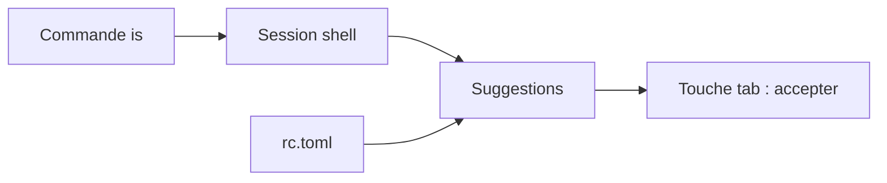

# microsoft/inshellisense

> Autocomplétion de style IDE pour le shell, pour développeurs qui tapent beaucoup de commandes.

## Le problème
Dans un terminal, on retape des options de commandes de mémoire, sans suggestions comme dans un éditeur.

## Ce que ça fait vraiment
Il ouvre une session de shell avec un menu de suggestions pour plus de 600 outils en ligne de commande. Il fonctionne avec bash, zsh, fish, pwsh, PowerShell, xonsh, nushell, et cmd en mode expérimental. Raccourcis, bordures et couleurs se règlent dans un fichier TOML.

## Comment c'est branché
Schéma simplifié d'après la fiche, sans diagramme fourni.



## Essayer
```bash
npm install -g @microsoft/inshellisense
is init
is doctor
is
```

## Coût et pièges
Gratuit, licence MIT. Il faut Node et ajouter le plugin en dernière ligne du fichier de configuration du shell, sinon la configuration peut casser.

## Ce que ce n'est pas
Ce n'est pas un remplaçant de shell : il enveloppe celui que tu utilises. Le mode cmd reste expérimental.

## Alternatives
Aucune alternative nommée dans le README.

## Pour toi
Adopter : gain immédiat et sans risque pour qui passe ses journées en terminal, avec un installateur simple et un éditeur connu.

