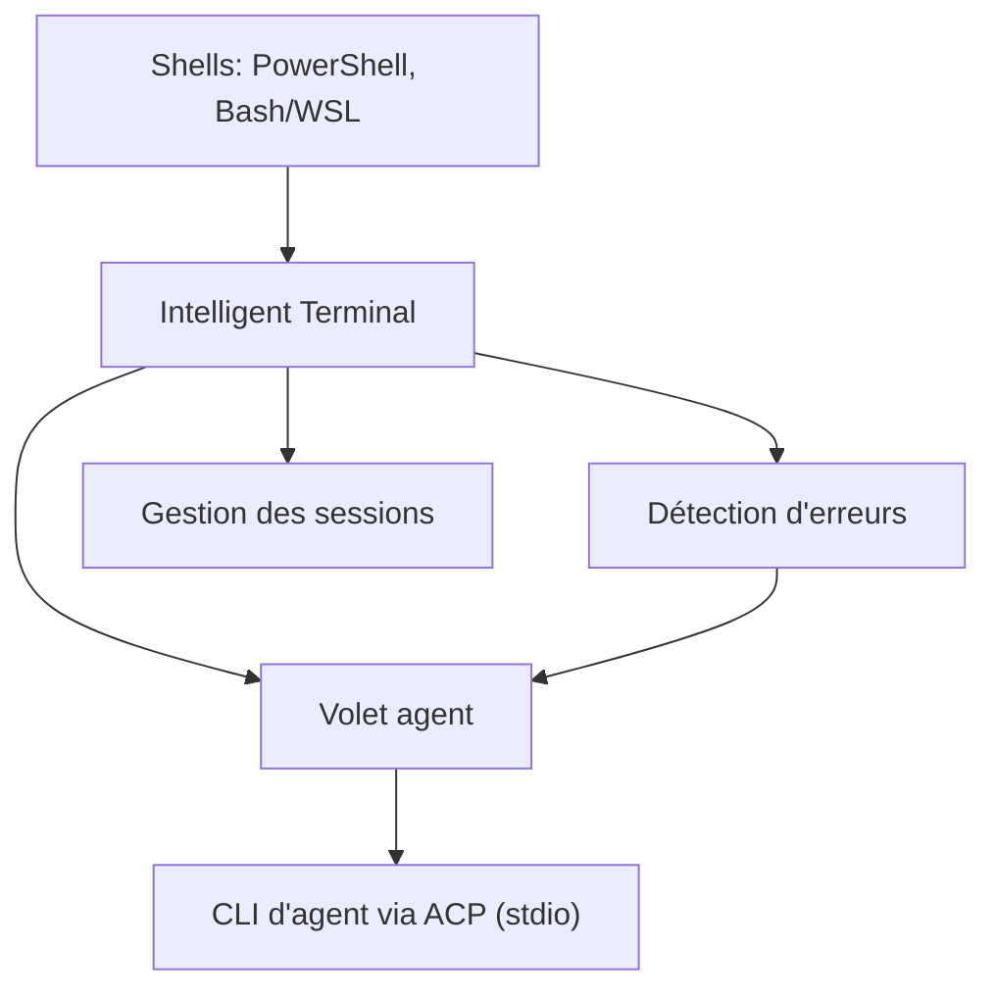

# microsoft/intelligent-terminal

> Experimental fork of Windows Terminal with an agent pane compatible with any ACP agent.

## The problem
To ask an agent for help with a terminal error, you copy-paste the output and context between two windows.

## What it actually does
It adds to Windows Terminal an agent pane that receives the context of the shells (PowerShell, Bash/WSL). It detects command errors, suggests fixes and launches background tasks from the command palette. It works with any ACP-compatible agent (Copilot, Claude, Codex, Gemini, OpenCode, Antigravity), including in-house providers via BYOK. No command is run without your approval.

## How it is wired
Simplified diagram based on the sheet, no diagram provided.



## Trying it
```powershell
winget install --id Microsoft.IntelligentTerminal -e
```

## Cost and gotchas
An agent and its subscription are required; GitHub Copilot is the default and is installed via WinGet. Windows 10 2004 or later. Depending on the chosen agent, your prompts and shell context go to its provider. Usage data is sent to Microsoft, can be disabled.

## What it is not
Not an agent: it carries your prompts and context to the chosen agent. It calls no cloud API itself. The README states it is in an experimental phase; it installs alongside Windows Terminal.

## Alternatives
No alternative named in the README.

## For you
Watch if you work on Windows or WSL with coding agents: the built-in pane saves copy-pasting, but the tool is experimental and sends telemetry.
