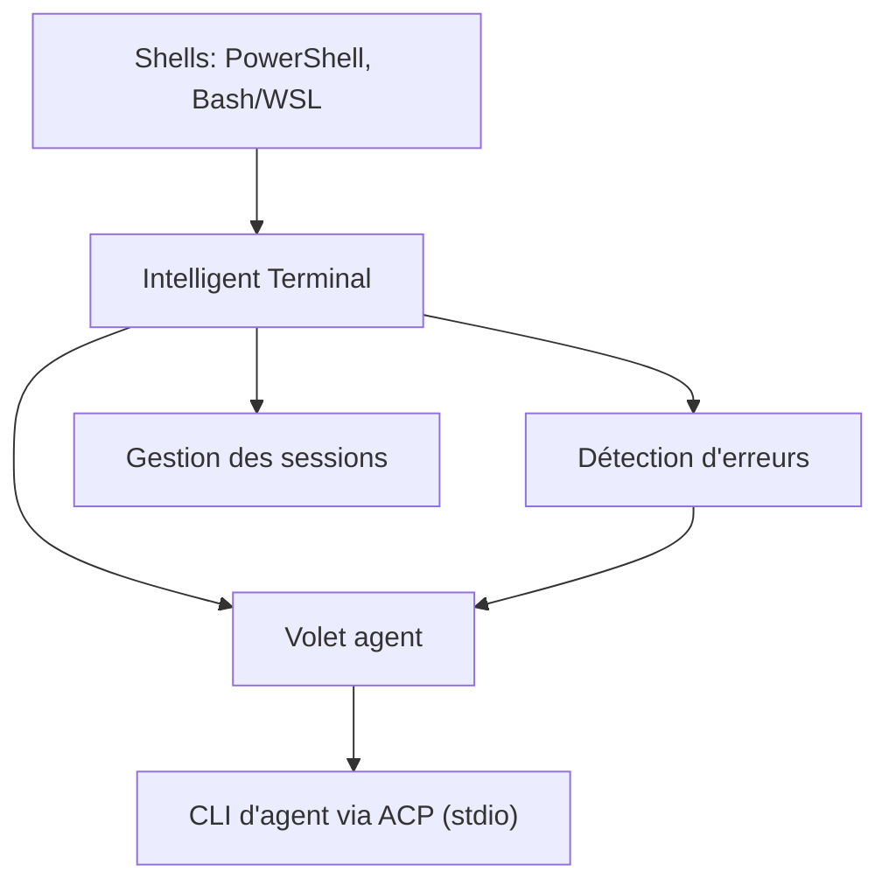

# microsoft/intelligent-terminal

> Fork expérimental de Windows Terminal avec un volet agent compatible avec tout agent ACP.

## Le problème
Pour demander de l'aide à un agent sur une erreur de terminal, on copie-colle la sortie et le contexte entre deux fenêtres.

## Ce que ça fait vraiment
Il ajoute à Windows Terminal un volet agent qui reçoit le contexte des shells (PowerShell, Bash/WSL). Il détecte les erreurs de commande, propose des correctifs et lance des tâches en arrière-plan depuis la palette de commandes. Il fonctionne avec tout agent compatible ACP (Copilot, Claude, Codex, Gemini, OpenCode, Antigravity), y compris des fournisseurs maison via BYOK. Aucune commande n'est exécutée sans ton accord.

## Comment c'est branché
Schéma simplifié d'après la fiche, sans diagramme fourni.



## Essayer
```powershell
winget install --id Microsoft.IntelligentTerminal -e
```

## Coût et pièges
Il faut un agent et son abonnement ; GitHub Copilot est le défaut et s'installe via WinGet. Windows 10 2004 ou plus. Selon l'agent choisi, tes prompts et ton contexte shell partent chez son fournisseur. Des données d'usage sont envoyées à Microsoft, désactivables.

## Ce que ce n'est pas
Ce n'est pas un agent : il transporte tes prompts et le contexte vers l'agent choisi. Il n'appelle aucune API cloud lui-même. Le README le dit en phase expérimentale ; il s'installe à côté de Windows Terminal.

## Alternatives
Aucune alternative nommée dans le README.

## Pour toi
À surveiller si tu travailles sous Windows ou WSL avec des agents de code : le volet intégré épargne le copier-coller, mais l'outil est expérimental et envoie de la télémétrie.

