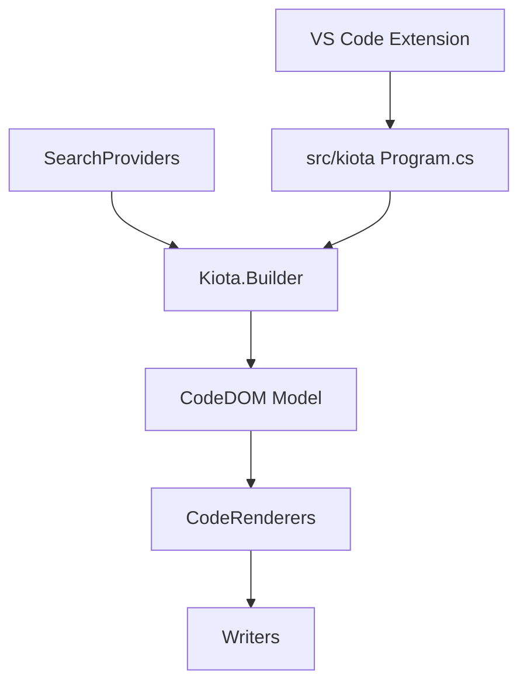

# microsoft/kiota

> Command-line generator of typed API clients from an OpenAPI description, for developers.

## The problem
Each API requires its own SDK, with its own conventions, which multiplies dependencies.

## What it actually does
It reads an OpenAPI description (via Microsoft.OpenAPI.NET), builds a code model (CodeDOM) then renders it in the target language: TypeScript, C#, Java, Go, Python and others. A CLI host exposes handlers (generate, search, add) and an RPC server for VS Code and IntelliJ extensions. An npm package wraps it. Description sources include GitHub and APIs.guru.

## How it is wired


## Trying it
```bash
# Aucune commande dans ce README : les étapes (installer, générer, appeler)
# renvoient aux pages de documentation et à la référence des paramètres.
```

## Cost and gotchas
Free, MIT. You need to install the tools specific to each target language (table in the README). The documented debugging goes through Visual Studio Code. The code includes telemetry (AppInsights and OpenTelemetry according to the architecture), to be checked before use.

## What it is not
Not a ready-to-use SDK: it generates the client from a specification. Quality depends on the OpenAPI description provided.

## Alternatives
No alternative named in the README.

## For you
Watch: generates typed Python clients to call model or ML platform APIs, but the tool is in .NET and the telemetry needs examining.
