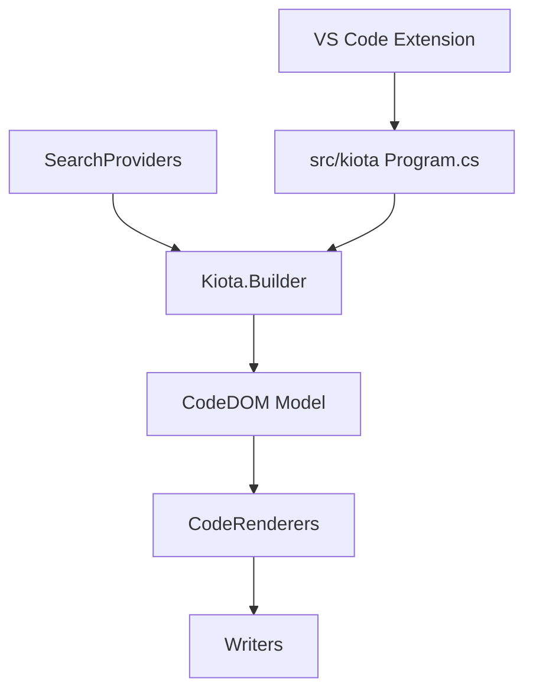

# microsoft/kiota

> Générateur en ligne de commande de clients d'API typés à partir d'une description OpenAPI, pour développeurs.

## Le problème
Chaque API demande son SDK propre, avec ses conventions, ce qui multiplie les dépendances.

## Ce que ça fait vraiment
Il lit une description OpenAPI (via Microsoft.OpenAPI.NET), construit un modèle de code (CodeDOM) puis le rend dans le langage cible : TypeScript, C#, Java, Go, Python et d'autres. Un hôte CLI expose des gestionnaires (générer, rechercher, ajouter) et un serveur RPC pour des extensions VS Code et IntelliJ. Un paquet npm l'enveloppe. Les sources de description incluent GitHub et APIs.guru.

## Comment c'est branché


## Essayer
```bash
# Aucune commande dans ce README : les étapes (installer, générer, appeler)
# renvoient aux pages de documentation et à la référence des paramètres.
```

## Coût et pièges
Gratuit, MIT. Il faut installer les outils propres à chaque langage cible (tableau du README). Le débogage documenté passe par Visual Studio Code. Le code intègre de la télémétrie (AppInsights et OpenTelemetry d'après l'architecture), à vérifier avant usage.

## Ce que ce n'est pas
Pas un SDK prêt à l'emploi : il génère le client depuis une spécification. La qualité dépend de la description OpenAPI fournie.

## Alternatives
Aucune alternative nommée dans le README.

## Pour toi
À surveiller : génère des clients Python typés pour appeler des API de modèles ou de plateformes ML, mais l'outil est en .NET et la télémétrie est à examiner.

