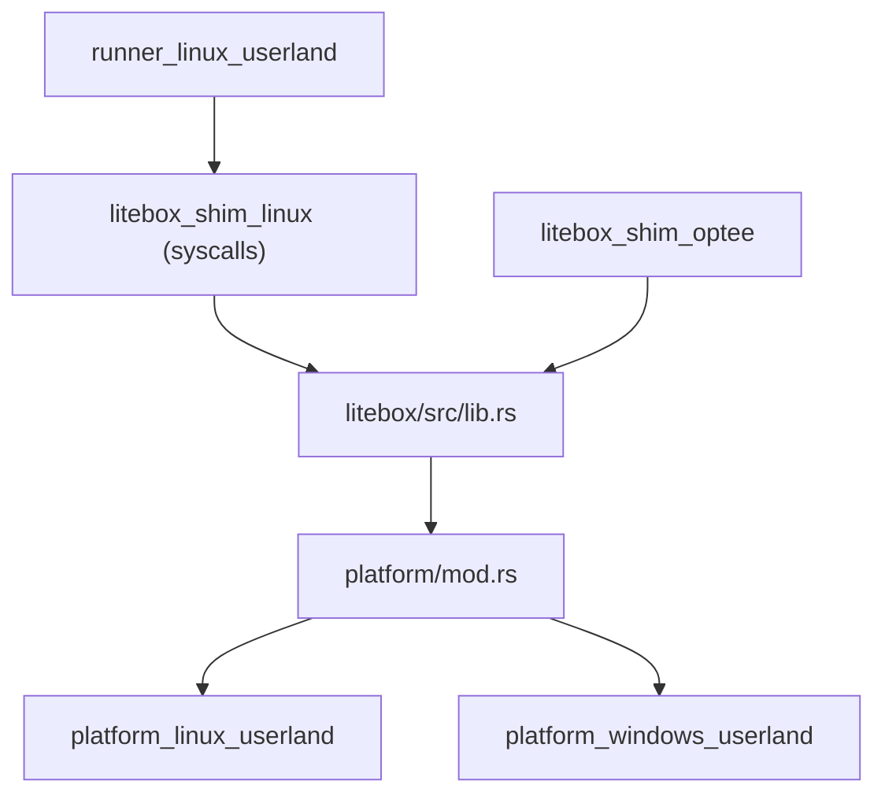

# microsoft/litebox

> Library operating system in Rust that reduces the attack surface to isolate programs.

## The problem
Running or isolating a program with a very small interface to the host, including inside a kernel or a confidential environment.

## What it actually does
A common core (files, network, memory) receives system calls translated by "north" shims (Linux, OP-TEE) and relies on a "south" Platform interface (Linux userland, Windows userland, LVBS, Linux kernel). Cited use cases: running Linux programs on Windows, isolating applications, SEV SNP, OP-TEE. APIs are subject to change.

## How it is wired

## Trying it
No command in the README: it gives neither installation nor a run example. To test, you must clone the repository and look for an entry point in its sources or documentation; nothing is documented here.

## Cost and gotchas
Free. Project under active development, unstable APIs according to the README warning. You need Rust and a good level in systems programming.

## What it is not
Not a ready-to-use container or virtual machine. Not yet stable.

## Alternatives
No alternative cited in the README.

## For you
Watch: isolating untrusted code is relevant to running AI agents, but the project is still unstable.
