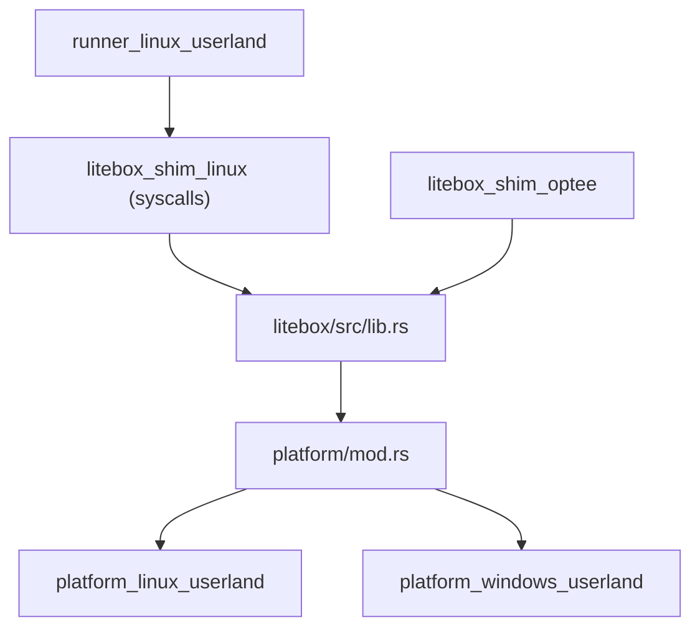

# microsoft/litebox

> Système d'exploitation bibliothèque en Rust qui réduit la surface d'attaque pour isoler des programmes.

## Le problème
Exécuter ou isoler un programme avec une interface très réduite vers l'hôte, y compris dans un noyau ou un environnement confidentiel.

## Ce que ça fait vraiment
Un noyau commun (fichiers, réseau, mémoire) reçoit les appels système traduits par des shims « nord » (Linux, OP-TEE) et s'appuie sur une interface Platform « sud » (Linux userland, Windows userland, LVBS, noyau Linux). Cas cités : exécuter des programmes Linux sur Windows, isoler des applications, SEV SNP, OP-TEE. API susceptibles de changer.

## Comment c'est branché

## Essayer
Aucune commande dans le README : il ne donne ni installation ni exemple d'exécution. Pour tester, il faut cloner le dépôt et chercher un point d'entrée dans ses sources ou sa documentation ; rien n'est documenté ici.

## Coût et pièges
Gratuit. Projet en évolution active, API instables selon l'avertissement du README. Il faut Rust et un bon niveau en systèmes.

## Ce que ce n'est pas
Pas un conteneur ni une machine virtuelle prête à l'emploi. Pas encore stable.

## Alternatives
Aucune alternative citée dans le README.

## Pour toi
Surveiller : l'isolation de code non fiable intéresse l'exécution d'agents IA, mais le projet est encore instable.

