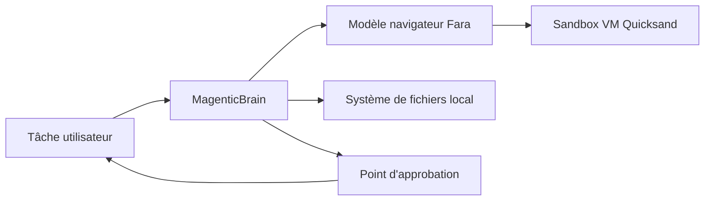

# microsoft/magentic-ui

> Browser and file agent designed to run with small models, under supervision.

## The problem
Agents that fill in forms or do web research require frontier models,
hence expensive compute, and often act with no stopping point before a critical action.

## What it actually does
MagenticLite pairs a locally runnable orchestrator (MagenticBrain) with a browser-specialized
model (Fara). It works both in the browser and on the local file system:
web research, form filling and file tidying in a single flow. The user can
steer, approve or take back control at any time, and the agent stops to ask before a
critical action. Browsing sessions run in a lightweight VM (Quicksand).

## How it is wired


## Trying it
```bash
mkdir magentic-lite && cd magentic-lite
uv venv --python=3.12 --seed .venv
source .venv/bin/activate
uv pip install "magentic_ui>=0.2.0"
magentic-ui --port 8081
```

## Cost and gotchas
You must connect a model endpoint, to host yourself or rent: cost is on you.
Supported on macOS and Windows via WSL; other platforms point to the installation guide.
Version 0.1, designed for frontier models, survives on a separate branch.

## What it is not
Not an autonomous agent: it stops and asks before sensitive actions, by design.
Not exhaustive — the repository publishes a "Limitations" page listing what it handles poorly, and a
transparency note on risks and intended uses. No license in the README.

## Alternatives
No alternative repository is named in the README.

## For you
Worth testing if you want to assess what a small model can do in browser automation.
