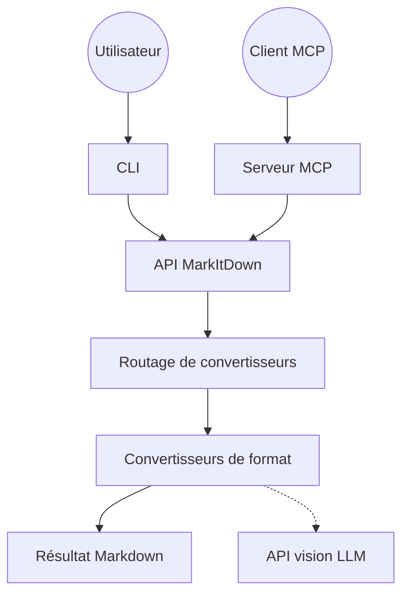

# microsoft/markitdown

> Converter tool for PDF, Office documents, images, and audio into Markdown, designed for use in LLM pipelines.

## The problem
A heterogeneous corpus (PDF, DOCX, XLSX, PPTX, ZIP, EPUB) cannot be directly fed into an LLM. Generic extractors flatten the text, losing headings, lists, and tables.

## What it actually does
Converts approximately twenty formats to Markdown while preserving the document's structure.
Optional dependencies by format (`[pdf]`, `[docx]`, `[xlsx]`, `[audio-transcription]…`).
A system of third-party plugins, which are disabled by default, including `markitdown-ocr`, which uses a large language model (LLM) for optical character recognition.
Two optional Azure connectors: Document Intelligence and Content Understanding (for audio, video, and fields).

## How it is wired


## Trying it
```bash
pip install 'markitdown[all]'
markitdown path-to-file.pdf > document.md
cat path-to-file.pdf | markitdown
markitdown --list-plugins
```

## Cost and gotchas
Free within the local environment. The Azure paths (`--use-cu`, `-d`) charge each `convert()` call.
Python 3.10+. The input is not sanitized: `convert()` reads both local files and remote URLs.

## What it is not
Not a high-fidelity conversion tool for human reading – the output is intended for automated analysis.
Not an OCR: OCR requires a plugin and a vision model key, which are silently ignored without a client.
The project refuses to use web servers, hosted APIs, or graphical interfaces.

## Alternatives
- `PaddlePaddle/PaddleOCR`: If the documents are scanned and the layout is important.
- `unclecode/crawl4ai`: if the source is the web rather than office documents.

## For you
The default converter for a document ingestion pipeline. Highly recommended.
