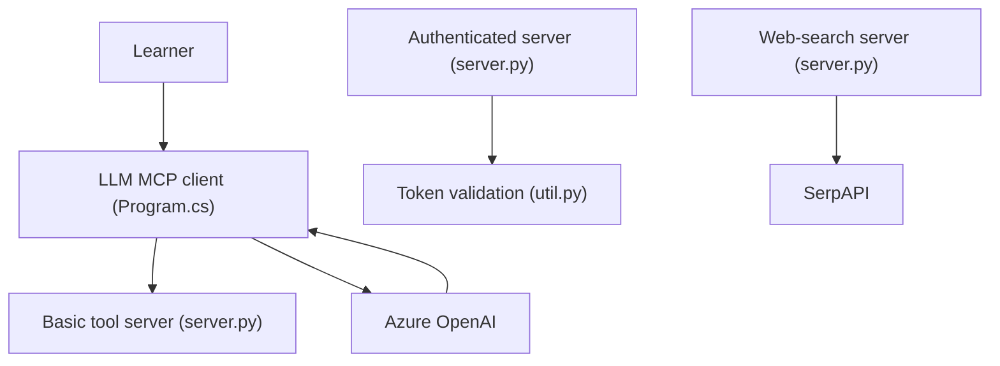

# microsoft/mcp-for-beginners

> Progressive Microsoft course for learning the Model Context Protocol, with examples in several languages.

## The problem
The MCP protocol evolves quickly, and scattered tutorials mix specification versions and languages.

## What it actually does
A curriculum in modules: basics, security, first server and client, stdio and HTTP transports, authentication, MCP Apps, sampling, deployment, then a PostgreSQL workshop in 13 labs. Examples exist in C#, Java, JavaScript, Python, TypeScript and Rust. The course targets the 2026-07-28 specification, with some examples remaining at 2025-11-25. More than 50 translations are provided.

## How it is wired

This repository is not a single application but a series of lessons.

## Trying it
```bash
git clone --filter=blob:none --sparse https://github.com/microsoft/mcp-for-beginners.git
cd mcp-for-beginners
git sparse-checkout set --no-cone '/*' '!translations' '!translated_images'
```

## Cost and gotchas
Free to read. Some examples call Azure OpenAI or SerpAPI (keys at your expense). The full clone is heavy because of the translations, hence the sparse checkout.

## What it is not
Not a library or a server to deploy as is: these are teaching examples, sometimes out of step with the latest SDKs.

## Alternatives
No alternative named in the README (it points to the official MCP documentation).

## For you
Adopt: a structured, up-to-date path for building MCP skills, with nothing to install at the start.
