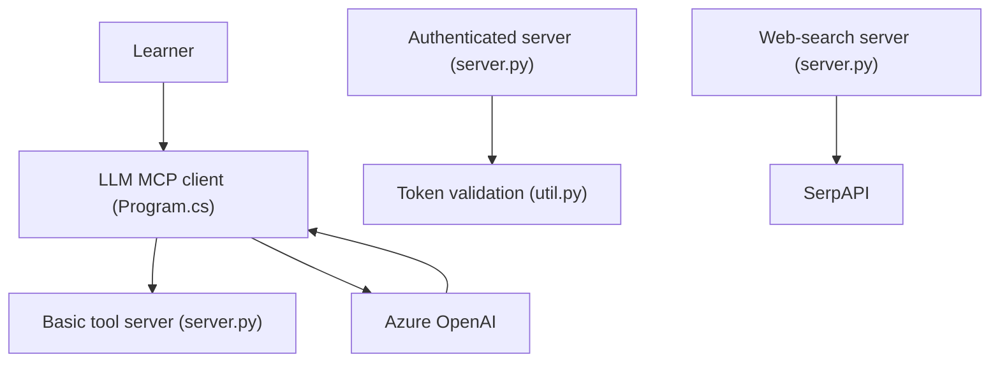

# microsoft/mcp-for-beginners

> Cours progressif de Microsoft pour apprendre le Model Context Protocol avec des exemples en plusieurs langages.

## Le problème
Le protocole MCP évolue vite, et les tutoriels dispersés mêlent versions de spécification et langages.

## Ce que ça fait vraiment
Un curriculum en modules : bases, sécurité, premier serveur et client, transports stdio et HTTP, authentification, MCP Apps, sampling, déploiement, puis un atelier PostgreSQL en 13 labs. Les exemples existent en C#, Java, JavaScript, Python, TypeScript et Rust. Le cours cible la spécification 2026-07-28, certains exemples restant à 2025-11-25. Plus de 50 traductions sont fournies.

## Comment c'est branché

Ce dépôt n'est pas une application unique mais une suite de leçons.

## Essayer
```bash
git clone --filter=blob:none --sparse https://github.com/microsoft/mcp-for-beginners.git
cd mcp-for-beginners
git sparse-checkout set --no-cone '/*' '!translations' '!translated_images'
```

## Coût et pièges
Gratuit à lire. Certains exemples appellent Azure OpenAI ou SerpAPI (clés à ta charge). Le clone complet est lourd à cause des traductions, d'où le sparse checkout.

## Ce que ce n'est pas
Pas une bibliothèque ni un serveur à déployer tel quel : ce sont des exemples pédagogiques, parfois décalés par rapport aux derniers SDK.

## Alternatives
Aucune alternative nommée dans le README (renvoie à la documentation officielle MCP).

## Pour toi
À adopter : parcours structuré et à jour pour monter en compétence sur MCP, sans rien installer au départ.

