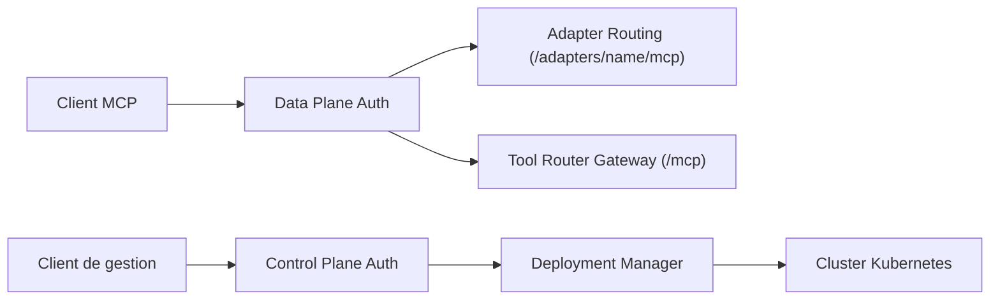

# microsoft/mcp-gateway

> Reverse proxy and management layer for MCP servers on Kubernetes, with routing and sessionless authorization.

## The problem
Deploying and exposing several MCP servers behind a single entry point requires routing, authentication and lifecycle management.

## What it actually does
The data plane routes each MCP request to a ready instance (`/adapters/{name}/mcp`) and to a tool router (`/mcp`). The control plane uses a REST API to manage the deployment of "adapters" and tools on Kubernetes. Authentication by token and roles (Entra ID in the cloud), a React portal, metadata in Redis or Cosmos DB. Agents and sessions exist in preview, disabled by default.

## How it is wired


## Trying it
```bash
docker run -d -p 5000:5000 --name registry registry:2.7
kubectl apply -f deployment/k8s/local-deployment.yml
kubectl port-forward -n adapter svc/mcpgateway-service 8000:8000
```

## Cost and gotchas
Breaking change: this version requires MCP clients `2026-07-28`, with no legacy initialization or transport sessions. The Azure deployment creates AKS, ACR, Cosmos DB, Application Gateway and Application Insights, and requires Owner access: plan for the bill. The agents module requires a Foundry endpoint and is limited to a single instance.

## What it is not
It is not an MCP server: it hosts them and routes to them. The shell and file tools built into the agents are disabled for everyone. The README provided is truncated at the end of the documentation.

## Alternatives
No alternative named in the README.

## For you
Worth watching: relevant if you need to expose MCP servers to several teams on Kubernetes; heavy to set up for individual use.
