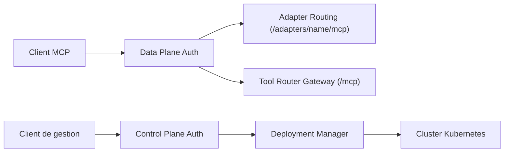

# microsoft/mcp-gateway

> Passerelle inverse et couche de gestion pour serveurs MCP sur Kubernetes, avec routage et autorisation sans session.

## Le problème
Déployer et exposer plusieurs serveurs MCP derrière un point d'entrée unique demande routage, authentification et gestion du cycle de vie.

## Ce que ça fait vraiment
Le plan de données route chaque requête MCP vers une instance prête (`/adapters/{name}/mcp`) et vers un routeur d'outils (`/mcp`). Le plan de contrôle gère par API REST le déploiement des « adapters » et des outils sur Kubernetes. Authentification par jeton et rôles (Entra ID en cloud), portail React, métadonnées dans Redis ou Cosmos DB. Des agents et sessions existent en préversion, désactivés par défaut.

## Comment c'est branché


## Essayer
```bash
docker run -d -p 5000:5000 --name registry registry:2.7
kubectl apply -f deployment/k8s/local-deployment.yml
kubectl port-forward -n adapter svc/mcpgateway-service 8000:8000
```

## Coût et pièges
Rupture de compatibilité : cette version exige des clients MCP `2026-07-28`, sans initialisation héritée ni sessions de transport. Le déploiement Azure crée AKS, ACR, Cosmos DB, Application Gateway et Application Insights, et demande un accès Owner : prévois la facture. Le module d'agents requiert un endpoint Foundry et reste réservé à une instance unique.

## Ce que ce n'est pas
Ce n'est pas un serveur MCP : il en héberge et les route. Les outils shell et fichiers intégrés aux agents sont désactivés pour tous. Le README fourni est tronqué en fin de documentation.

## Alternatives
Aucune alternative nommée dans le README.

## Pour toi
À surveiller : pertinent si tu dois exposer des serveurs MCP à plusieurs équipes sur Kubernetes ; lourd à mettre en place pour un usage individuel.

