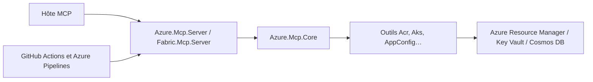

# microsoft/mcp

> Microsoft repository hosting the Azure and Fabric MCP servers, with a catalog of other MCP servers.

## The problem
Connecting an agent to Azure, Fabric or Microsoft 365 without standardized tools means hacking together API calls service by service.

## What it actually does
.NET monorepo with a core library `Azure.Mcp.Core`, servers (`Azure.Mcp.Server`, `Fabric.Mcp.Server`) and per-service tools (Acr, Aks, AppConfig…). The README also catalogs remote or local servers: Foundry, GitHub, Playwright, Dataverse, SQL, Sentinel, Teams, Mail, Word. Azure extension for Copilot CLI and Claude Code.

## How it is wired


## Trying it
```bash
/plugin marketplace add microsoft/skills
/plugin install azure-skills@skills
/plugin update azure-skills@skills
```

## Cost and gotchas
The repo is free, but the targeted services (Azure, Microsoft 365, Fabric) require accounts, permissions and billed resources. Several listed servers are separate repos.

## What it is not
Not a single server: a catalog plus two servers built here. The others live in their own repos.

## Alternatives
- github/github-mcp-server: GitHub server listed in the catalog.
- microsoft/playwright-mcp: browser control listed in the catalog.

## For you
Worth watching: relevant if your platform is Azure or Fabric; the index of Microsoft MCP servers also serves as a map for connecting agents to company data.
