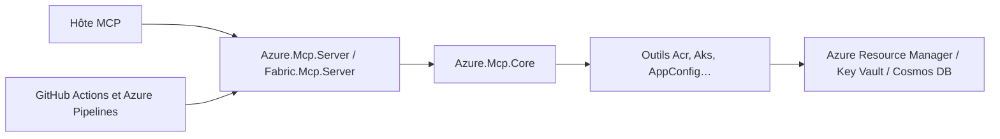

# microsoft/mcp

> Dépôt de Microsoft hébergeant les serveurs MCP Azure et Fabric, avec un catalogue d'autres serveurs MCP.

## Le problème
Brancher un agent sur Azure, Fabric ou Microsoft 365 sans outils standardisés revient à bricoler des appels d'API par service.

## Ce que ça fait vraiment
Monorepo .NET avec une bibliothèque cœur `Azure.Mcp.Core`, des serveurs (`Azure.Mcp.Server`, `Fabric.Mcp.Server`) et des outils par service (Acr, Aks, AppConfig…). Le README catalogue aussi des serveurs distants ou locaux : Foundry, GitHub, Playwright, Dataverse, SQL, Sentinel, Teams, Mail, Word. Extension Azure pour Copilot CLI et Claude Code.

## Comment c'est branché


## Essayer
```bash
/plugin marketplace add microsoft/skills
/plugin install azure-skills@skills
/plugin update azure-skills@skills
```

## Coût et pièges
Le dépôt est gratuit, mais les services ciblés (Azure, Microsoft 365, Fabric) exigent des comptes, des droits et des ressources facturées. Plusieurs serveurs listés sont des dépôts distincts.

## Ce que ce n'est pas
Pas un seul serveur : un catalogue plus deux serveurs construits ici. Les autres vivent dans leurs propres dépôts.

## Alternatives
- github/github-mcp-server : serveur GitHub listé dans le catalogue.
- microsoft/playwright-mcp : pilotage de navigateur listé dans le catalogue.

## Pour toi
À surveiller : pertinent si ton plateau est Azure ou Fabric ; l'index des serveurs MCP Microsoft sert aussi de carte pour brancher des agents sur les données de l'entreprise.

